# Guide för administratörer

Den här guiden är för styrelsens administratörer. Den visar hur du sköter medlemsregistret, avgifterna, erbjudandena, volontärpassen, handlingarna och utskicken på föreningens webbplats. Allt utgår från administrationens översikt, som du når med länken **Administration** längst ner på varje sida.

Evenemang, nyheter och informationssidor redigeras i Sanity, inte här. Länken **Redigera och publicera i Sanity** på översikten leder dit.

Bilderna kommer från en testversion av webbplatsen med påhittade personer.

## Logga in

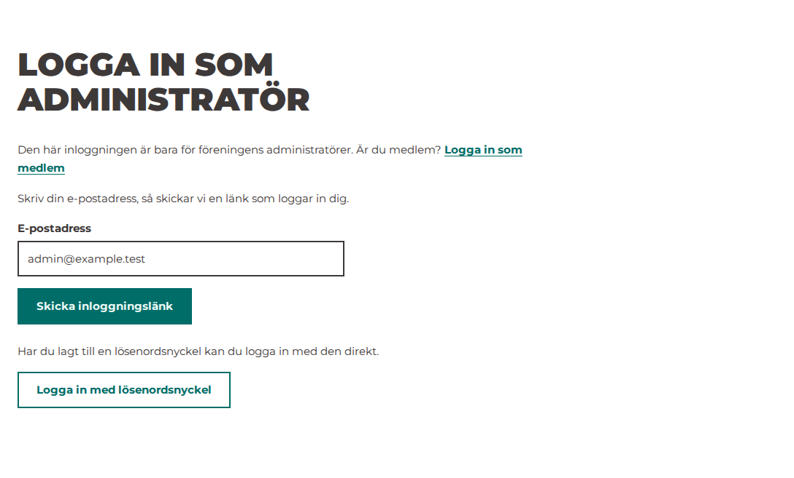

1. Tryck på **Administration** längst ner på webbplatsen.
2. Skriv din e-postadress och tryck **Skicka inloggningslänk**.
3. Öppna mejlet och tryck på länken. Länken gäller i en timme, och bara i den webbläsare där du bad om den.

Läser du mejlet på en annan enhet, till exempel telefonen, skriv i stället koden från mejlet på sidan som väntar i webbläsaren där du bad om länken.

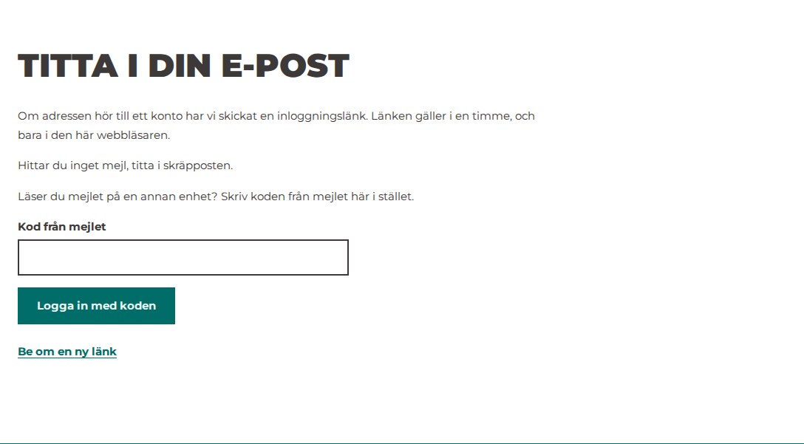

Öppnar du länken i en annan webbläsare säger sidan det. Be då om en ny länk i den webbläsare du vill använda.

Efter inloggningen kommer du till översikten. Menyn överst leder till resten.

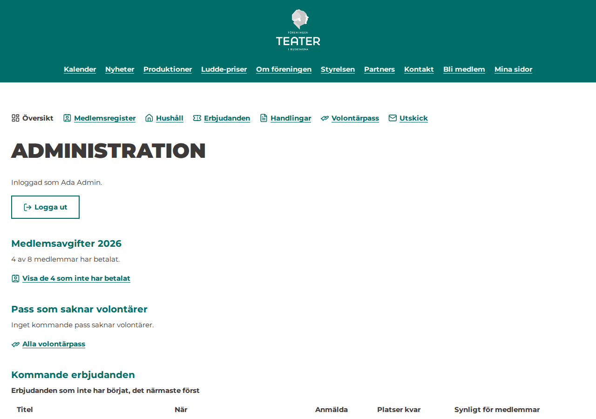

### Logga in med en lösenordsnyckel

En lösenordsnyckel loggar in dig med fingeravtryck, ansiktet eller skärmlåsets kod, utan att du väntar på ett mejl.

1. Logga in med en länk.
2. Tryck **Lägg till lösenordsnyckel** under **Lösenordsnycklar** på översikten, och godkänn i webbläsarens fråga.
3. Nästa gång trycker du **Logga in med lösenordsnyckel** på inloggningssidan.

Efter en inloggning med länk frågar sidan om du vill lägga till en lösenordsnyckel. **Inte nu** frågar igen nästa gång, **Fråga inte igen** gör det inte.

### Logga ut andra enheter

Under **Inloggade enheter** på översikten står varje webbläsare där du är inloggad. Känner du inte igen en, tryck **Logga ut** på dess rad. **Logga ut på alla andra enheter** loggar ut alla utom den du sitter vid.

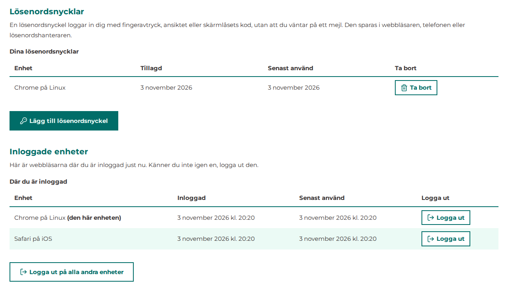

**Logga ut** överst på översikten loggar ut den här webbläsaren.

## Medlemsregistret

### Söka

1. Tryck **Medlemsregister** i administrationsmenyn.
2. Skriv en del av ett namn, en e-postadress, ett telefonnummer eller en ort och tryck **Sök**.
3. **Har inte betalat** visar bara dem som inte har betalat årets avgift och **Har betalat** bara dem som har det. **Alla** visar alla igen.

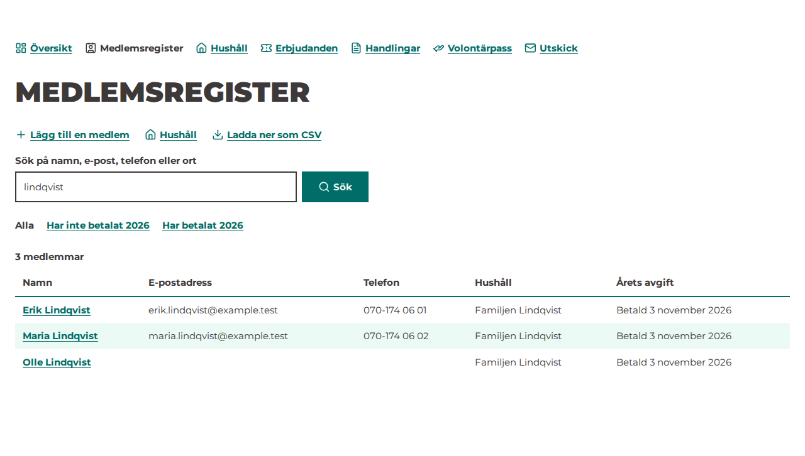

### Lägga till en medlem

1. Tryck **Lägg till en medlem** i medlemsregistret.
2. Fyll i namnet och det du vet av resten. Välj ett hushåll om medlemmen ska ingå i ett.
3. Tryck **Lägg till**.

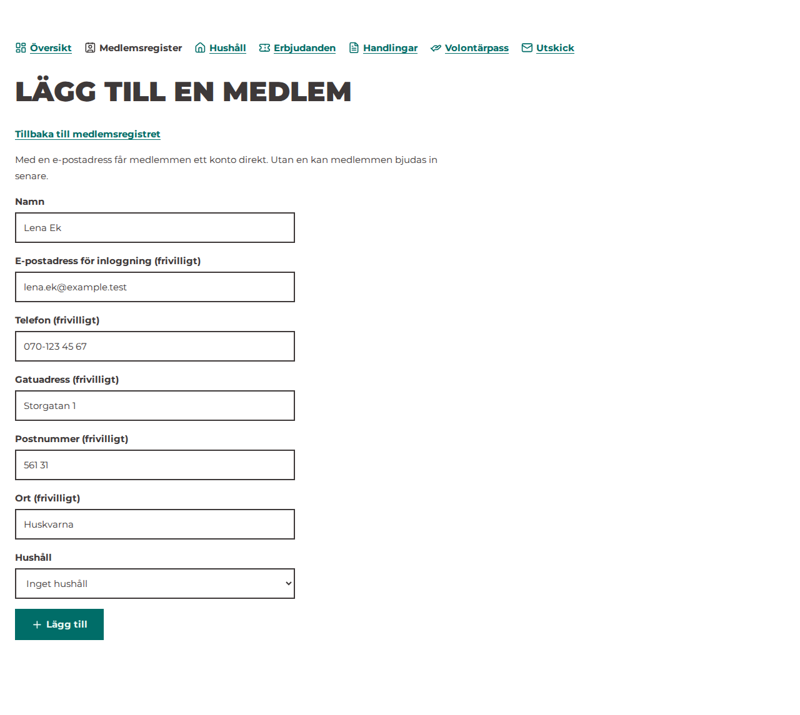

Med en e-postadress får medlemmen ett konto direkt och kan logga in under Mina sidor. Utan en e-postadress kan du bjuda in medlemmen senare: under **Bjud in till konto** på medlemmens sida skriver du adressen och trycker **Skicka inbjudan**.

### Ändra uppgifter

1. Tryck på medlemmens namn i medlemsregistret.
2. Ändra under **Ändra uppgifter** och tryck **Spara**.

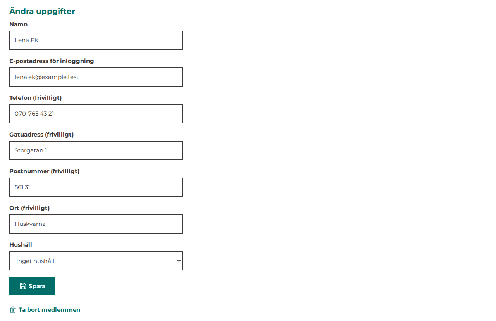

### Ta bort en medlem

1. Tryck **Ta bort medlemmen** längst ner på medlemmens sida.
2. Läs vad som tas bort och tryck **Ta bort**. **Avbryt** tar dig tillbaka utan att något händer.

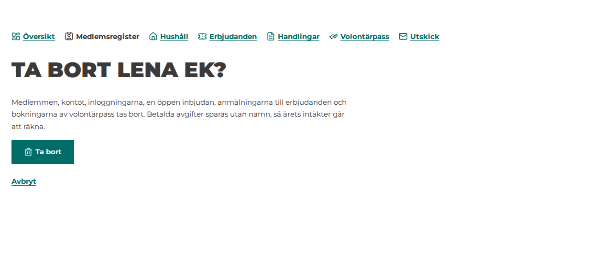

Medlemmen, kontot, inloggningarna och en öppen inbjudan tas bort, och med dem medlemmens anmälningar till erbjudanden och bokade volontärpass. Betalda avgifter sparas utan namn, så att årets intäkter fortfarande går att räkna. Det går inte att ångra.

## Hushåll och familjemedlemskap

Ett hushåll kan betala en gemensam avgift, som då täcker alla i hushållet.

1. Tryck **Hushåll** i administrationsmenyn.
2. Skriv ett namn under **Skapa ett hushåll**, till exempel Familjen Sjöberg, och tryck **Skapa**.
3. Öppna varje medlem som ska ingå, välj hushållet under **Ändra uppgifter** och tryck **Spara**.

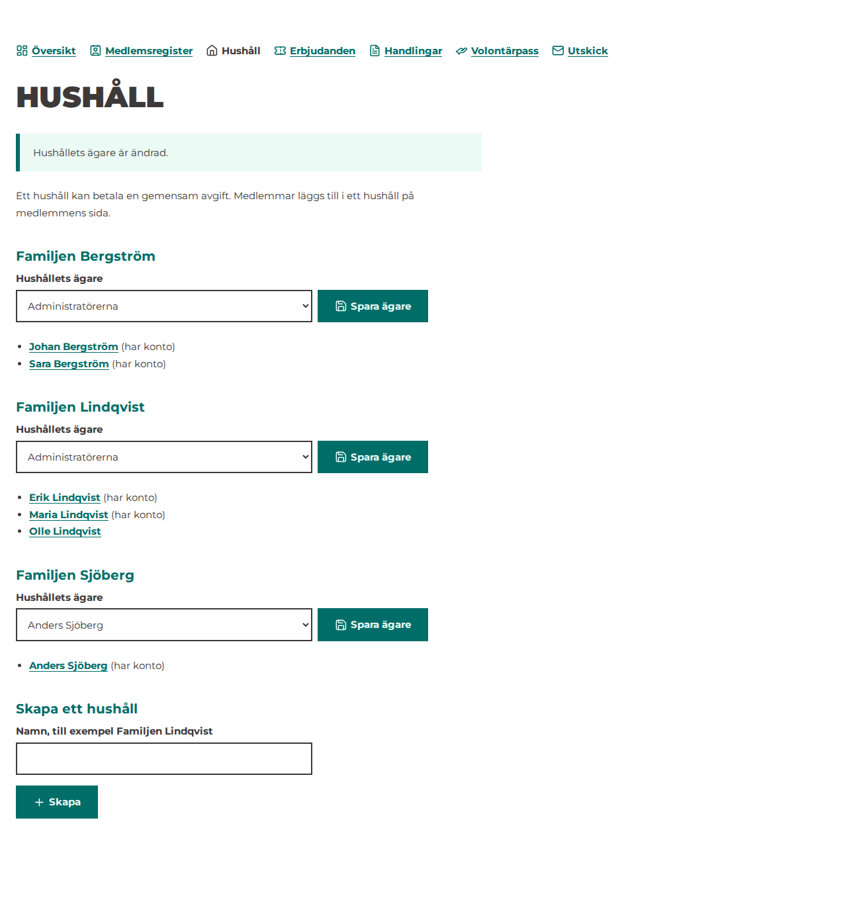

Varje hushåll har en ägare, som sköter hushållet från Mina sidor: bjuder in, ändrar och tar bort personer i det. Ägaren måste ha ett konto. Står ägaren på **Administratörerna** sköter ni hushållet härifrån. Byt ägare genom att välja en annan under **Hushållets ägare** och trycka **Spara ägare**.

## Markera en avgift som betald

Medlemmarna betalar till föreningens bankgiro och skriver sin e-postadress i meddelandet. När en betalning syns på kontot:

1. Tryck **Medlemsregister** och sedan **Har inte betalat**.
2. Sök på e-postadressen från betalningens meddelande.
3. Tryck **Betald, enskild** på medlemmens rad, eller **Betald, hushåll** om betalningen är hushållets avgift.

Medlemmen försvinner från listan över dem som inte har betalat. Översikten räknar hur många som har betalat i år.

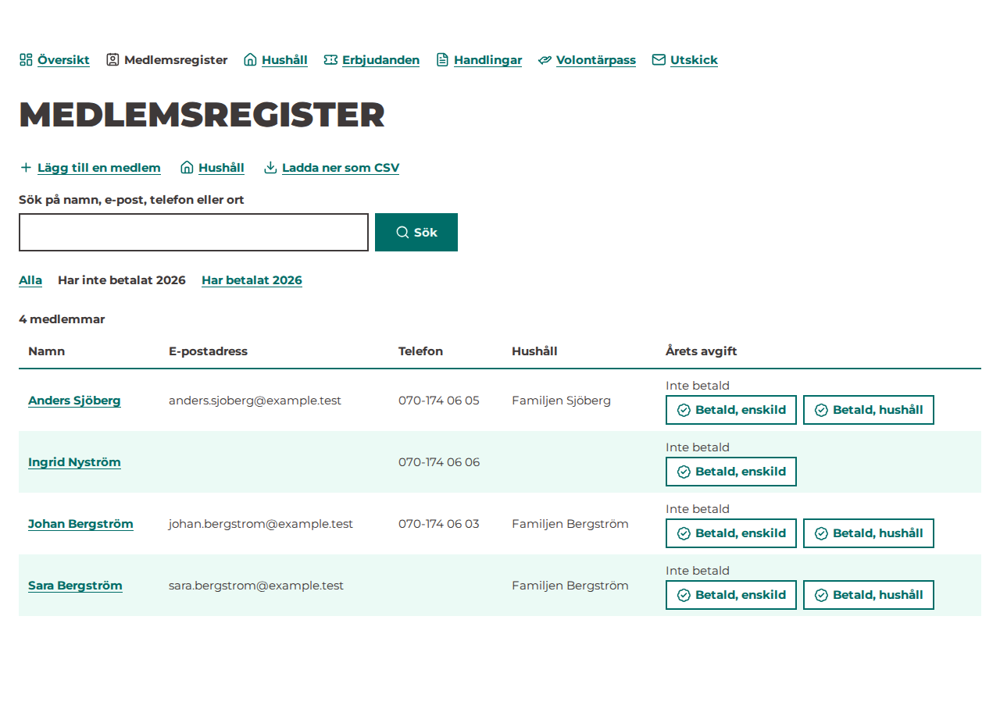

Hittar du ingen med adressen kan meddelandet vara avkortat eller utan @. Sök på början av adressen, eller på betalarens namn eller telefonnummer. Betalar någon för hela familjen kan betalaren heta något annat än medlemmen; kolumnen **Hushåll** visar vilka som hör ihop.

### Ett annat belopp, eller en betalning som ska ångras

Knapparna i registret markerar den ordinarie avgiften. Har någon betalat ett annat belopp:

1. Tryck på medlemmens namn.
2. Välj **Enskild medlem** eller **Hushåll, täcker alla i hushållet** under **Medlemsavgift**.
3. Skriv beloppet i kronor och tryck **Markera som betald**.

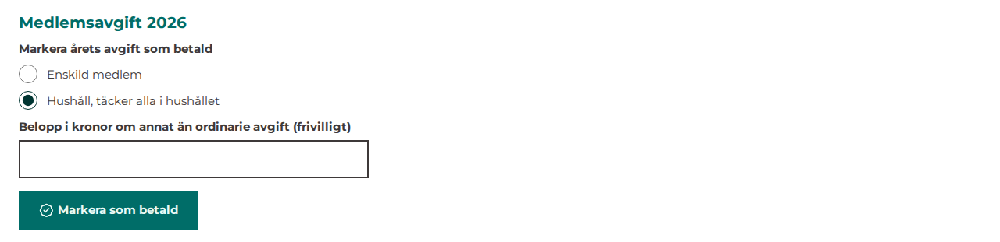

Blev det fel trycker du **Ångra betalningen** på medlemmens sida.

## Exportera registret

1. Tryck **Ladda ner som CSV** i medlemsregistret.
2. Öppna filen `medlemsregister.csv` i Excel eller ett annat kalkylprogram.

Filen har en rad per medlem med namn, e-post, telefon, adress, postnummer, ort, hushåll, om årets avgift är betald och när personen blev medlem.

**Filen innehåller personuppgifter om alla medlemmar.** Spara den bara på en dator som du själv använder, och radera den när du är klar. Lägg den inte i en delad mapp eller i en molntjänst som inte är föreningens, och skicka den inte med e-post eller i en chatt. Behöver någon annan uppgifterna, låt dem logga in och ladda ner själva. Samma sak gäller listorna över anmälda och volontärer nedan.

## Erbjudanden

Ett erbjudande är något medlemmarna kan anmäla sig till, till exempel en kurs, en resa eller en rabatt.

1. Tryck **Erbjudanden** i administrationsmenyn och sedan **Skapa ett erbjudande**.
2. Fyll i titel, beskrivning och när erbjudandet äger rum.
3. Fyll i **Anmälan stänger** om anmälan ska stänga före start. Lämnas fältet tomt stänger anmälan när erbjudandet börjar, och medlemmarna kan avanmäla sig fram till dess.
4. Fyll i **Antal platser**. Lämnas fältet tomt finns ingen gräns.
5. Tryck **Skapa**. Erbjudandet sparas som utkast, och medlemmarna ser det inte än.

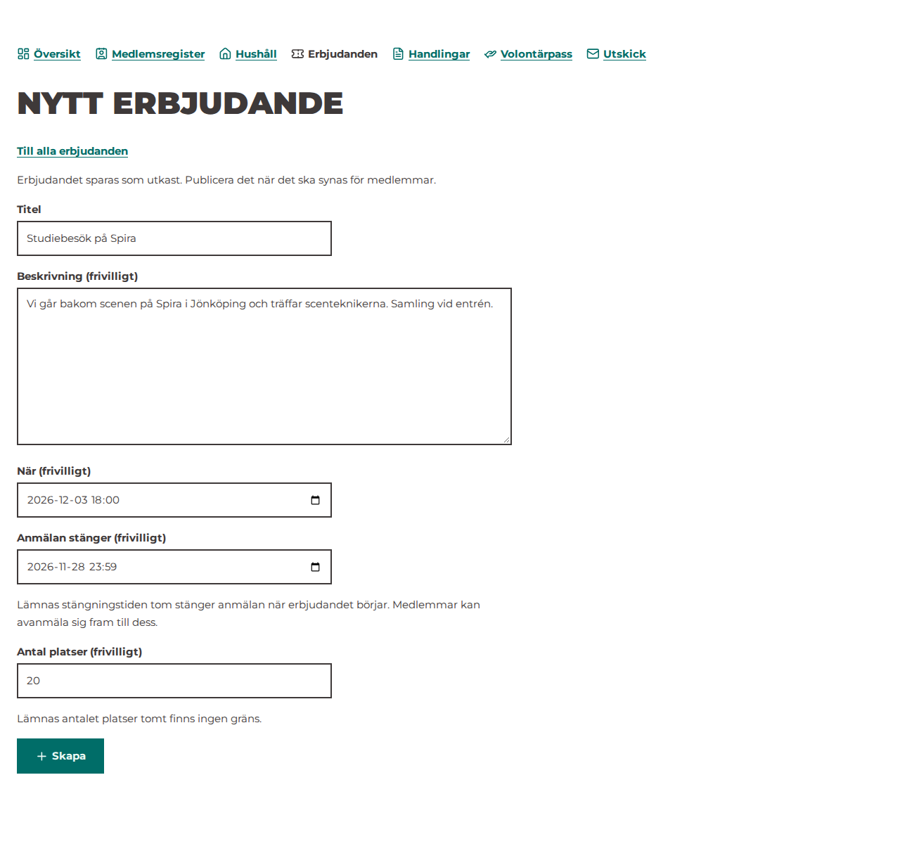

6. Tryck **Publicera** när erbjudandet ska synas för medlemmarna under Mina sidor.

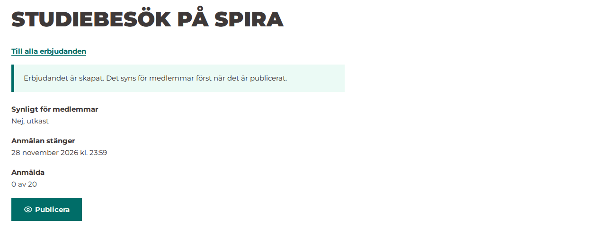

**Avpublicera** döljer erbjudandet igen. Under **Ändra erbjudandet** på samma sida ändrar du det, och **Ta bort erbjudandet** tar bort det.

Under **Anmälda** på erbjudandets sida står vilka som har anmält sig. **Ladda ner anmälningarna som CSV** ger dig listan som fil.

## Volontärpass

Ett volontärpass hör till ett evenemang. Formuläret visar bara evenemang som är publicerade i Sanity och äger rum i dag eller senare, så publicera evenemanget först.

1. Tryck **Volontärpass** i administrationsmenyn.
2. Välj evenemang och uppgift under **Lägg till ett pass**.
3. Fyll i när passet börjar och slutar, och hur många volontärer som behövs.
4. Tryck **Lägg till passet**.

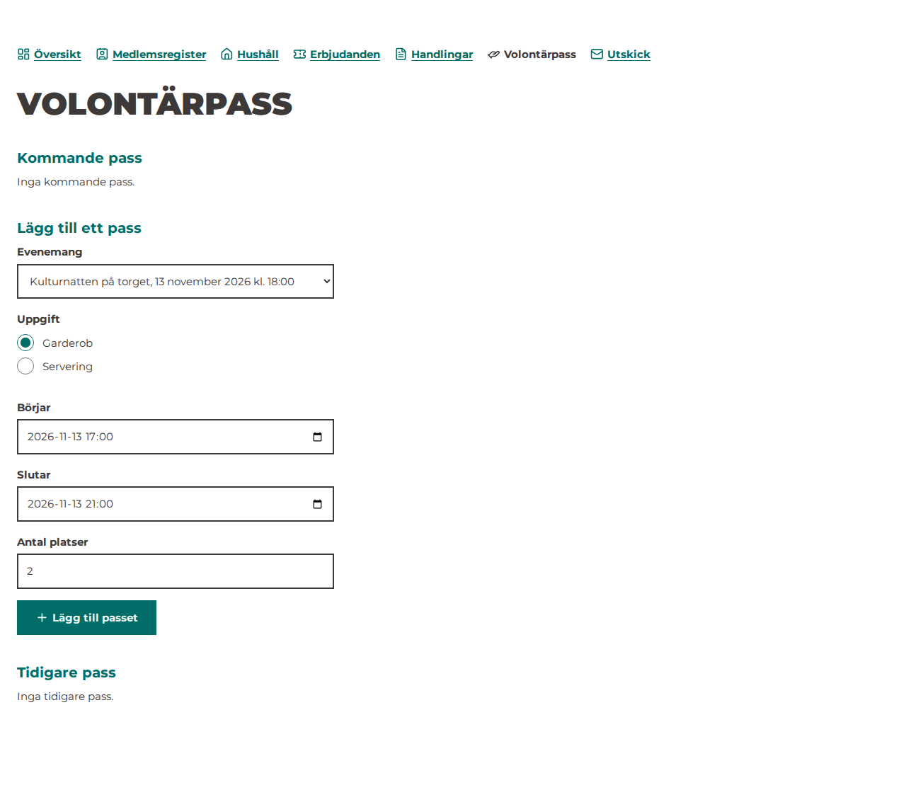

Medlemmarna bokar passen under Mina sidor. På passets sida ser du hur många som har bokat och vilka de är, med e-post och telefon, och **Ladda ner som CSV** ger dig listan som fil. Översikten visar kommande pass som saknar volontärer.

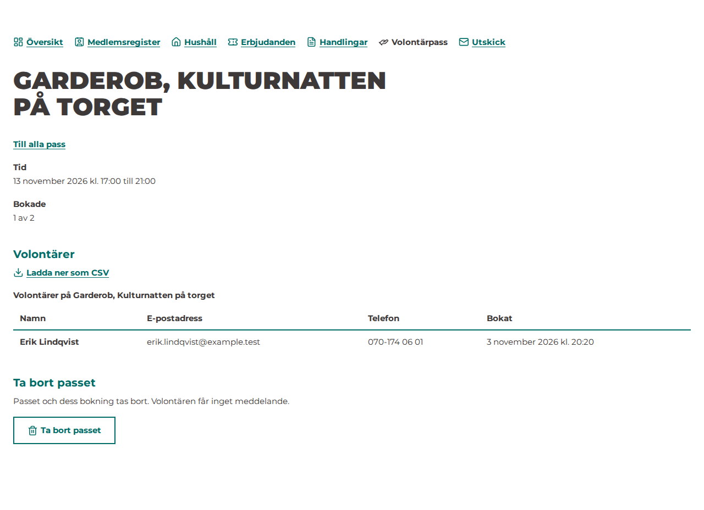

**Ta bort passet** tar bort passet och dess bokningar. Volontärerna får inget meddelande, så tala om det för dem själv.

## Handlingar

Handlingar är filer som medlemmarna kan läsa under Mina sidor, till exempel kallelsen och handlingarna till årsmötet.

1. Tryck **Handlingar** i administrationsmenyn.
2. Fyll i titel, välj sort och skriv datumet som står på handlingen.
3. Välj filen. Den måste vara en PDF och får vara högst 10 MB.
4. Tryck **Ladda upp**.

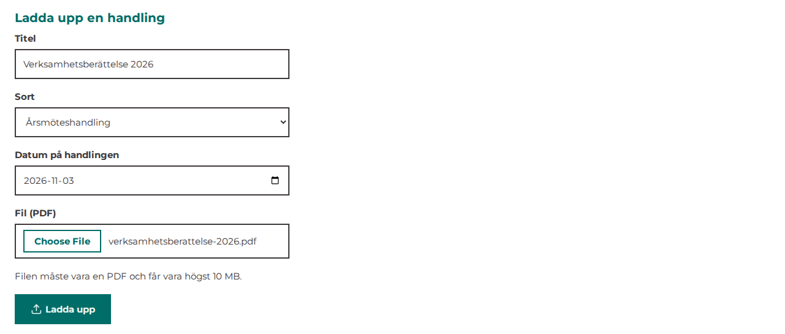

**Ta bort** på handlingens rad tar bort den.

## Utskick

Ett utskick är ett mejl till medlemmarna med din egen text och evenemang och nyheter från webbplatsen. Du gör det här, och skickar det från Brevo.

1. Tryck **Utskick** i administrationsmenyn.
2. Välj mottagare och skriv ett ämne.
3. Skriv din egen text. En tom rad börjar ett nytt stycke.
4. Kryssa i de evenemang och nyheter som ska med.
5. Tryck **Förhandsgranska**.

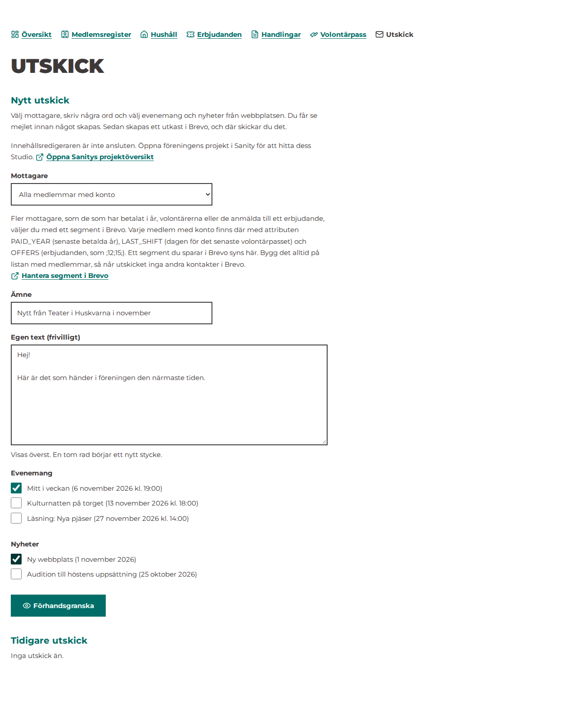

6. Läs mejlet som mottagarna kommer att få, och se hur många det når. **Ändra** tar dig tillbaka till formuläret.
7. Tryck **Skapa utkast i Brevo**. Inget skickas än.

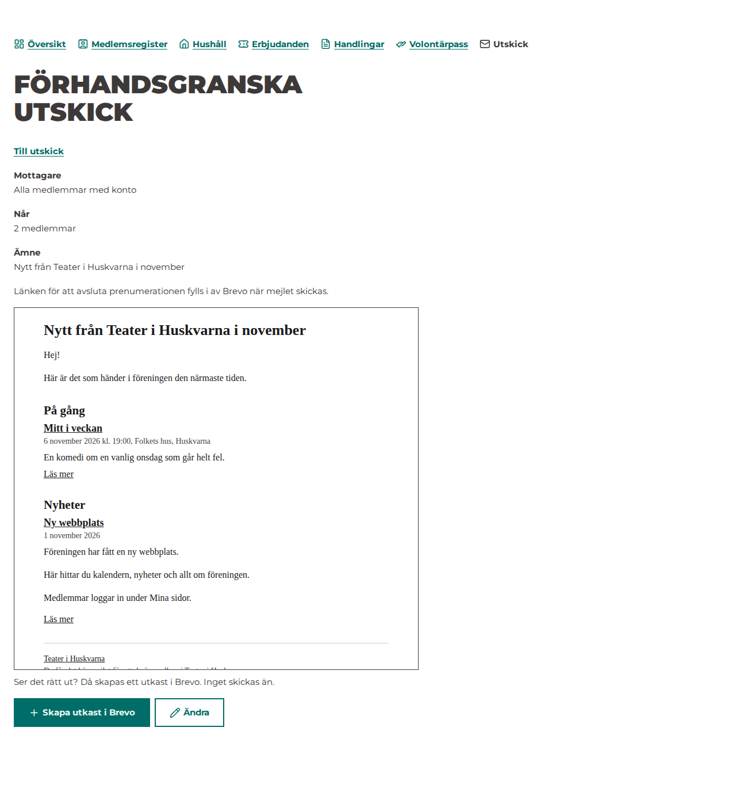

8. Tryck **Skicka ett test till mig** för att få utkastet i din egen inkorg.
9. Logga in i Brevo, öppna kampanjen med det id som sidan visar under Kampanjer, och välj när den ska skickas.

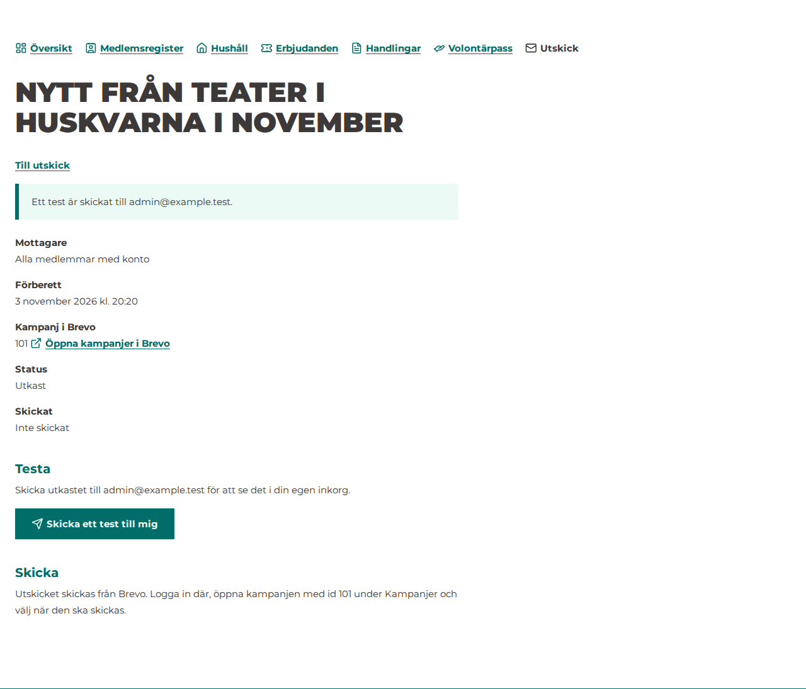

Under **Tidigare utskick** på sidan Utskick står alla utskick, det senaste först, med status och hur många som har öppnat dem.

### Målgrupper och segment

**Alla medlemmar med konto** finns alltid. Andra grupper, till exempel de som har betalat i år, volontärerna eller de anmälda till ett erbjudande, gör du som segment i Brevo. Varje medlem med konto finns där med tre egenskaper:

- `PAID_YEAR` är det senaste året medlemmen har betalat. För dem som har betalat i år är den årtalet.
- `LAST_SHIFT` är dagen för medlemmens senaste volontärpass.
- `OFFERS` är de erbjudanden medlemmen har anmält sig till, som `;12;15;`. Erbjudandets sida visar vad du ska söka på.

Bygg alltid segmentet på listan med medlemmar, så når utskicket inga andra kontakter i Brevo. Ett segment du sparar i Brevo syns under **Mottagare** här.

## Administratörer

Administratörerna står under **Administratörer** på översikten.

1. Skriv namn och e-postadress under **Lägg till en administratör**.
2. Tryck **Lägg till**. Den nya administratören loggar in med sin adress på inloggningssidan för administratörer.

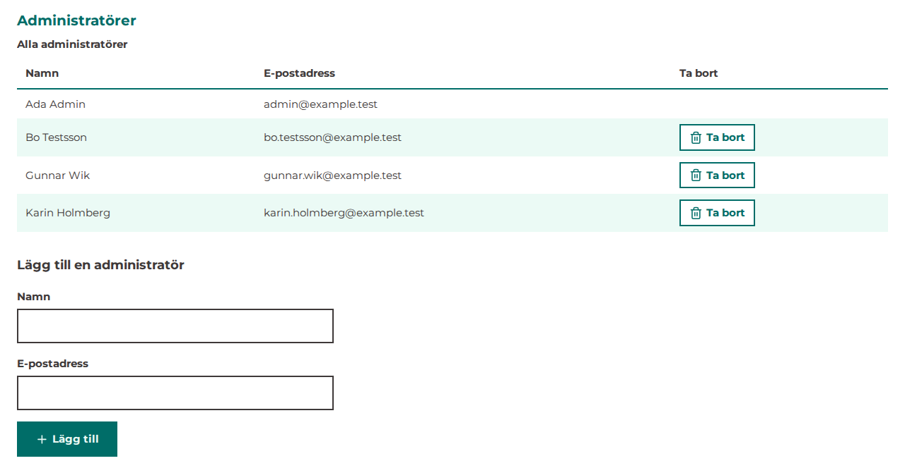

**Ta bort** på en rad tar bort administratören, loggar ut den överallt och tar bort dess lösenordsnycklar. Du kan inte ta bort dig själv; be en annan administratör göra det. Systemet vägrar också när bara två administratörer finns kvar, eftersom projektplanen kräver att minst två i styrelsen har tillgång.

## När något går fel

Kontakta systemets förvaltare: *ingen är utsedd än*. Vem som förvaltar systemet efter praktikperioden är fråga C2 i [open-questions.md](open-questions.md).

Skriv vad du gjorde, vad du väntade dig och vad som hände i stället, och ta gärna en skärmbild.

## Verifiering

En agent följde varje steg ovan den 3 november 2026 på en lokal testmiljö med webbplatsen som den ser ut när guiden publiceras, inloggad som den påhittade administratören Ada Admin, med ett skript som också tog bilderna. Skriptet kontrollerade att varje sida svarade som guiden säger, och från en påhittad medlems inloggning att medlemmarna ser det som guiden säger att de ser. Lösenordsnyckeln prövades med Chromiums låtsade autentiserare, inte med ett fingeravtryck eller en telefon.

Inte prövat:

- Stegen i Brevo. Den lokala miljön skickar utskick till en låtsad Brevo, så utkastet, testet och mottagargrupperna är inte prövade mot ett riktigt Brevo-konto.
- Att öppna CSV-filerna i Excel.
- En provkörning med någon som inte skrev guiden.
