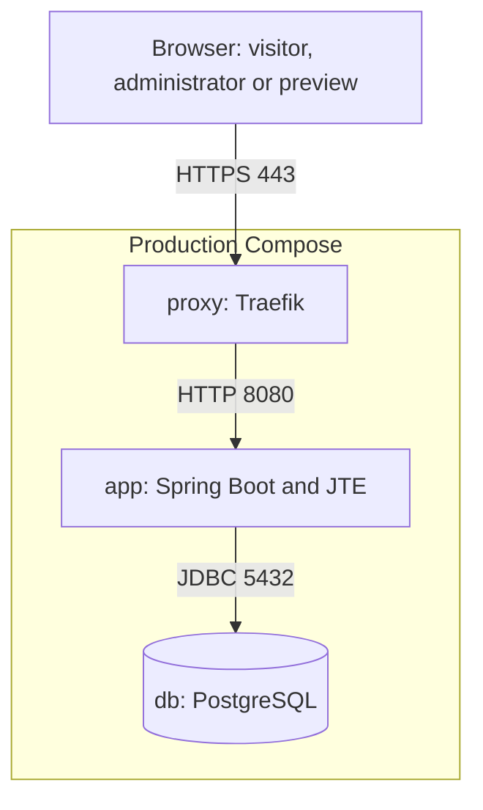
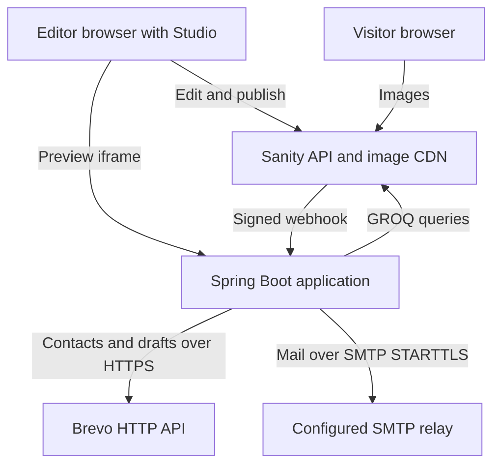
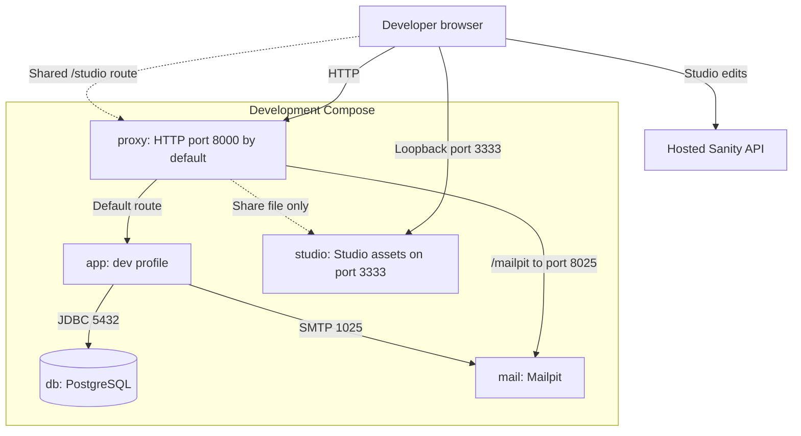
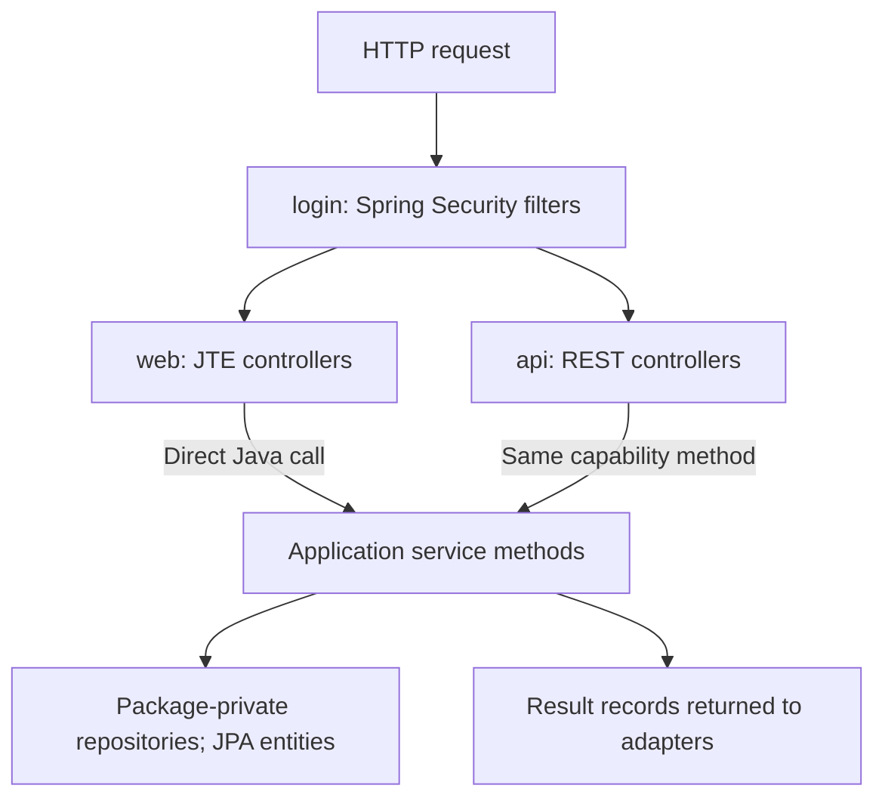

# Architecture

The site is one Spring Boot application. JTE renders HTML on the server; REST endpoints expose the same application services. PostgreSQL holds the member register and pending work. Sanity holds public content, and Brevo holds mailing campaigns and contacts.

This description follows code on `origin/main` at [b7247ec](https://github.com/AlexanderReaper7/teaterihuskvarna/commit/b7247ecb138611c50bfe6a1cb7a55c40bd013ba6), checked on 2026-11-11. It includes Flyway V18. It does not describe the separate login work on branch `214-logging-in-page`. The [system plan](projektplan.md) states the delivery requirements; the [decision records](decisions/) explain choices. The diagrams here describe what the code implements.

Start with this page, then follow the question that matters:

| Question | Read |
| --- | --- |
| What belongs in PostgreSQL, and how do the records relate? | [Data model](architecture/data.md) |
| What happens during login, publishing, a mailing or Bli medlem? | [Key flows](architecture/flows.md) |
| How does a fresh checkout run? | [README](../README.md#first-run) |
| How are production settings, backup and restore handled? | [Runbook](runbook.md) |
| What does account, member or mailing mean here? | [Glossary](../GLOSSARY.md) |

## Runtime and external services

### Production configuration

The boxes inside the Compose boundary are the three services in [compose.yaml](../compose.yaml). Arrows name requests or connections; their responses return on the same connection. The SMTP relay is configured separately from the Brevo HTTP API. Transactional mail includes login links, confirmations, invitations and shift reminders.

Traefik redirects port 80 to HTTPS and obtains certificates through Let's Encrypt. It reads routing labels through the Docker socket. The application and database publish no host ports in this file. The `postgres-data` volume keeps PostgreSQL data; `certificates` keeps Traefik's certificates. Member documents are database bytes, not files in the application container.

The application starts after the database health check. [application.yaml](../src/main/resources/application.yaml) enables Flyway migrations and Hibernate validation, with `open-in-view` disabled. Spring Session also stores sessions in PostgreSQL. A restart therefore preserves login tokens and sessions, but clears the in-memory content cache and preview signing key.

Studio's [configuration](../studio/sanity.config.ts) runs in the editor's browser and talks directly to Sanity. The editor deployment is separate from Compose, see [Studio instructions](../studio/README.md). Image addresses in rendered pages point directly to Sanity's CDN, see [Images](../src/main/java/se/teaterihuskvarna/content/Images.java). Member details, member-only offers, documents and volunteer bookings stay in PostgreSQL.

The external connections are shown separately so each label remains readable. Requests to the application below pass through the proxy in the preceding diagram.

### Development and sharing

[compose.dev.yaml](../compose.dev.yaml) changes the base stack and adds `mail` and [`studio`](../studio/). This diagram shows the development routes; the Sanity query, publish webhook and preview paths above still apply.

The `dev` profile sends SMTP mail to Mailpit, seeds invented members and exposes the development index and direct login helpers. It defaults to in-memory `FakeBrevo`, which sends no campaigns and forgets its state on restart. `BREVO_API=http` selects real Brevo calls even in development. Public pages use the hosted Sanity dataset `dev` by default; it includes imported real content as well as demo content. Automated tests select fixture content instead. Development is not offline.

The dev file exposes PostgreSQL only on loopback, port 5432 by default, and mounts [static assets](../src/main/resources/static/) for reload without rebuilding Java or templates. Studio's port is also loopback-only. [compose.share.yaml](../compose.share.yaml) adds no service. It adds Basic Auth to the site, Mailpit and the Studio route, and changes the site and preview addresses to `SHARE_URL`. The webhook route has its own Basic Auth setting and still needs a valid Sanity signature. A separately configured Tailscale Funnel forwards public traffic to the proxy; Compose does not start it. See [sharing instructions](../README.md#sharing-the-dev-stack).

The deployment rationale is in [ADR 0008 (Everything in containers)](decisions/0008-everything-in-containers.md). The implemented [build workflow](../.github/workflows/build.yml) tests and builds an image. It contains no GHCR push or SSH deployment. [backup.sh](../scripts/backup.sh) creates a local unencrypted dump when run; the repository implements no daily schedule or encrypted off-site copy. Operational steps and remaining release conditions belong in the [runbook](runbook.md) and [system plan](projektplan.md#security-fails-closed-and-backups-must-restore).

## Code map

The packages below are all under [se.teaterihuskvarna](../src/main/java/se/teaterihuskvarna/). An adapter converts an HTTP request to a service call and turns the result into HTML or JSON. The JTE controller calls Java directly; it does not call the REST endpoint.

The service box groups the capabilities in the package table; this is a request path, not a complete dependency graph. Services also call other services and external clients. Login link redemption and WebAuthn ceremonies run in Spring Security filters, not ordinary controllers. [ADR 0014 (One service layer, two adapters)](decisions/0014-one-service-layer-two-adapters.md) explains the adapter rule; [ADR 0012 (JPA over a schema Flyway owns)](decisions/0012-jpa-over-a-schema-flyway-owns.md) explains transactions and result records.

[AdapterRulesTest](../src/test/java/se/teaterihuskvarna/architecture/AdapterRulesTest.java) uses ArchUnit to forbid adapter dependencies on repositories, entities or the other adapter. Repositories must be package-private. Its parity check requires every service/component method used by `web` to be called from `api` too; it compares class and method names, not HTTP behaviour or method overload signatures. It allows extra API capabilities. It does not prove that every service returns a record.

| Package | Responsibility and starting point |
| --- | --- |
| [web](../src/main/java/se/teaterihuskvarna/web/) | Page controllers and HTML responses; [ContentPageController](../src/main/java/se/teaterihuskvarna/web/ContentPageController.java) is the public-page entry point. |
| [api](../src/main/java/se/teaterihuskvarna/api/) | REST controllers and [ProblemResponses](../src/main/java/se/teaterihuskvarna/api/ProblemResponses.java) for refusals. |
| [login](../src/main/java/se/teaterihuskvarna/login/) | Security chains, link tokens, passkeys, sessions, device management and transactional mail. Start at [SecurityConfiguration](../src/main/java/se/teaterihuskvarna/login/SecurityConfiguration.java). |
| [member](../src/main/java/se/teaterihuskvarna/member/) | Members, accounts, households, applications, invitations and fees. [FeeLedger](../src/main/java/se/teaterihuskvarna/member/FeeLedger.java) computes coverage. |
| [administrator](../src/main/java/se/teaterihuskvarna/administrator/) | Separate administrator accounts, first-account bootstrap and removal rules. |
| [content](../src/main/java/se/teaterihuskvarna/content/) | Sanity queries, published cache, preview passes and public content records. |
| [offer](../src/main/java/se/teaterihuskvarna/offer/) | Member-only offers, capacity and offer registrations. |
| [volunteer](../src/main/java/se/teaterihuskvarna/volunteer/) | Shifts, bookings and reminders; [ShiftStarted](../src/main/java/se/teaterihuskvarna/volunteer/ShiftStarted.java) reports started shifts for Brevo attributes. |
| [document](../src/main/java/se/teaterihuskvarna/document/) | Member document upload, validation and download. |
| [mailing](../src/main/java/se/teaterihuskvarna/mailing/) | Mailing preview, Brevo draft/test/report calls and member contact synchronization. |
| [outbox](../src/main/java/se/teaterihuskvarna/outbox/) | Persistent pending work, workers, retries and PostgreSQL notifications. |
| [export](../src/main/java/se/teaterihuskvarna/export/) | CSV formatting shared by service exports. |
| [development](../src/main/java/se/teaterihuskvarna/development/) | Dev-only route/environment listing and guard against production site settings. |
| [seed](../src/main/java/se/teaterihuskvarna/seed/) | Dev-only invented register data. |

The root package contains [Application](../src/main/java/se/teaterihuskvarna/Application.java), which enables scheduling, and shared clock, template, ID conversion and Swedish locale configuration. [ServiceRulesTest](../src/test/java/se/teaterihuskvarna/architecture/ServiceRulesTest.java) checks write transactions, service validation and API refusal handlers. [DevelopmentRulesTest](../src/test/java/se/teaterihuskvarna/architecture/DevelopmentRulesTest.java) checks that development tools require the `dev` profile. [LoginRemovalRulesTest](../src/test/java/se/teaterihuskvarna/architecture/LoginRemovalRulesTest.java) checks session and passkey cleanup when a login is removed. The remaining [architecture tests](../src/test/java/se/teaterihuskvarna/architecture/) cover narrower conventions, not the entire architecture.

## Where to change something

| Task | Start here |
| --- | --- |
| Add a capability | Its domain service, then both [web](../src/main/java/se/teaterihuskvarna/web/) and [api](../src/main/java/se/teaterihuskvarna/api/) adapters. |
| Change page markup or Swedish labels | [JTE templates](../src/main/jte/) and [messages_sv.properties](../src/main/resources/messages_sv.properties), per [ADR 0001 (Language policy)](decisions/0001-language-policy.md). |
| Add public content fields | [Studio schemas](../studio/schemaTypes/) and [content](../src/main/java/se/teaterihuskvarna/content/); inspect the [publishing and preview flows](architecture/flows.md#published-content). |
| Change stored data | A new [Flyway migration](../src/main/resources/db/migration/), affected domain classes and the [data model](architecture/data.md). |
| Investigate missing mail or stale Brevo contacts | [Outbox and contact flow](architecture/flows.md#outbox-and-brevo-contacts), then the [runbook](runbook.md). |
| Find behavioural examples | [Java tests](../src/test/java/se/teaterihuskvarna/) and [browser tests](../e2e/tests/). |

## Verification

Checked on 2026-11-11 against [b7247ec](https://github.com/AlexanderReaper7/teaterihuskvarna/commit/b7247ecb138611c50bfe6a1cb7a55c40bd013ba6). The checks below distinguish diagram syntax, source comparison and tested behaviour.

| Diagram | Check and result |
| --- | --- |
| Production configuration | Ran `docker compose --env-file /dev/null -f compose.yaml config --services` with a placeholder database password. Output was `db`, `app`, `proxy`. Compared ports, volumes and routes with the rendered configuration and the external-client classes linked above. |
| External connections | Traced query, webhook and image paths in the linked content classes and Studio configuration; traced SMTP through MailDelivery and campaign/contact calls through HttpBrevo. The focused tests in [flow verification](architecture/flows.md#verification) exercise these clients with substitutes. |
| Development and sharing | Repeated the service inventory with the dev file, then dev plus share. Both returned `db`, `mail`, `app`, `proxy`, [`studio`](../studio/). Compared profile, SMTP and routing overrides with both files. No extra share service exists. |
| Code map | Inventoried Java package declarations and matched all 14 child packages to the table. Ran `AdapterRulesTest`, `ServiceRulesTest`, `DevelopmentRulesTest` and `LoginRemovalRulesTest` in the focused Docker verification command recorded in [flow verification](architecture/flows.md#verification). |

Rendering and documentation-check results are recorded in [flow verification](architecture/flows.md#verification). These checks do not automatically compare diagram boxes or arrows with implementation. Compose/package inventories were manually compared here; the tests enforce only the named rules. A future drift check could compare the service and package inventories with diagram IDs and the package table. No such check is added by this documentation change. No production deployment or live external-service verification was performed.
