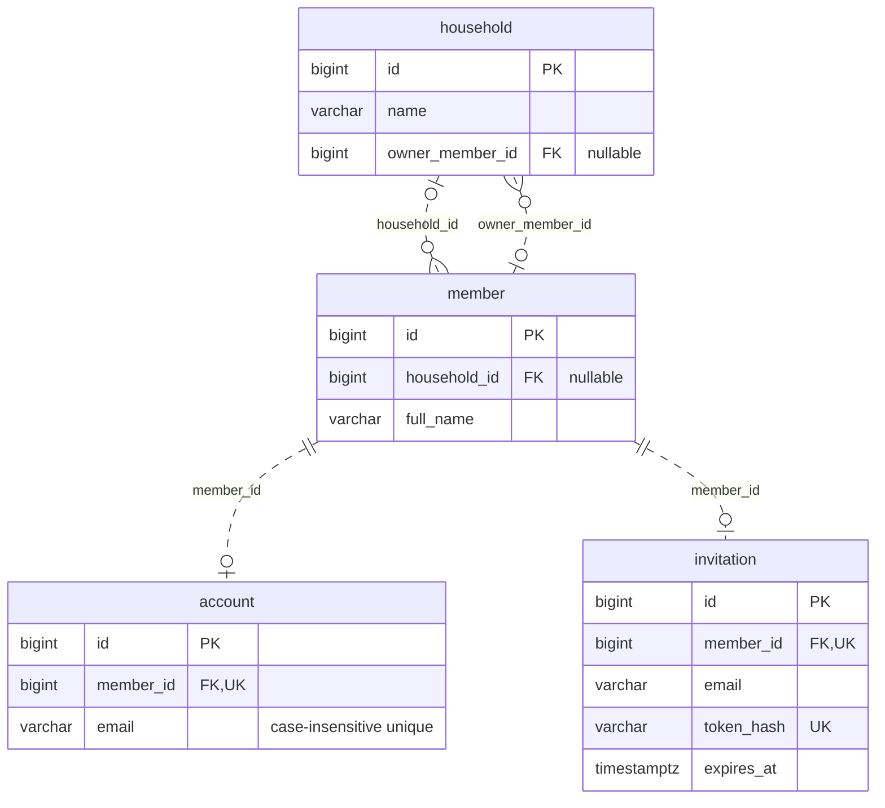
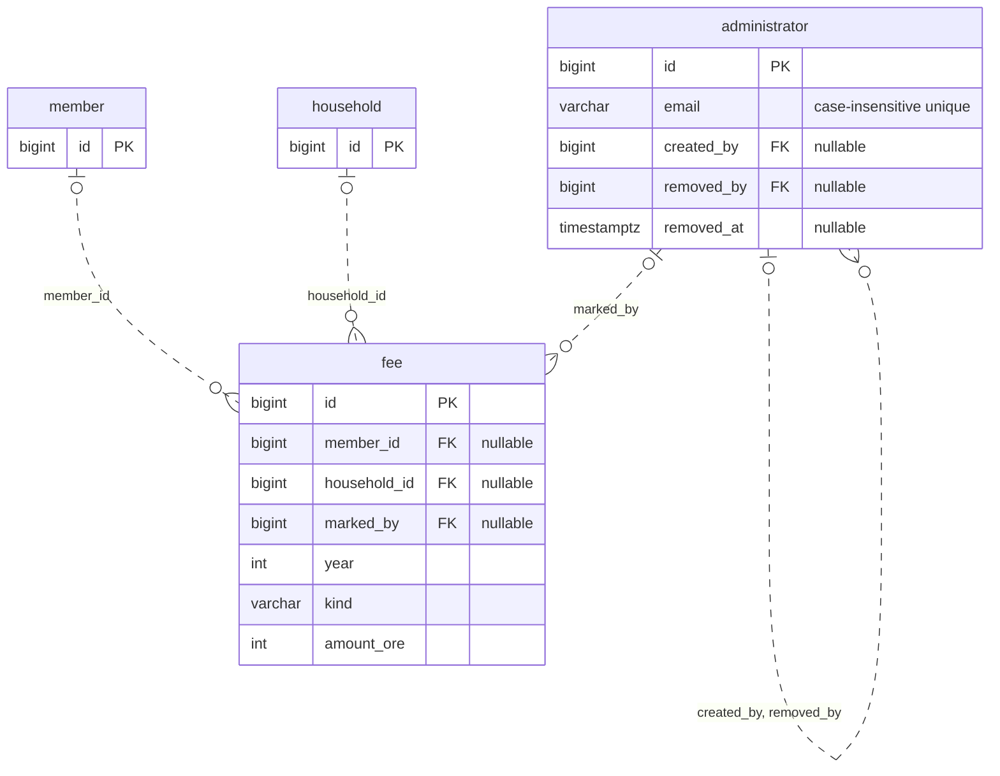
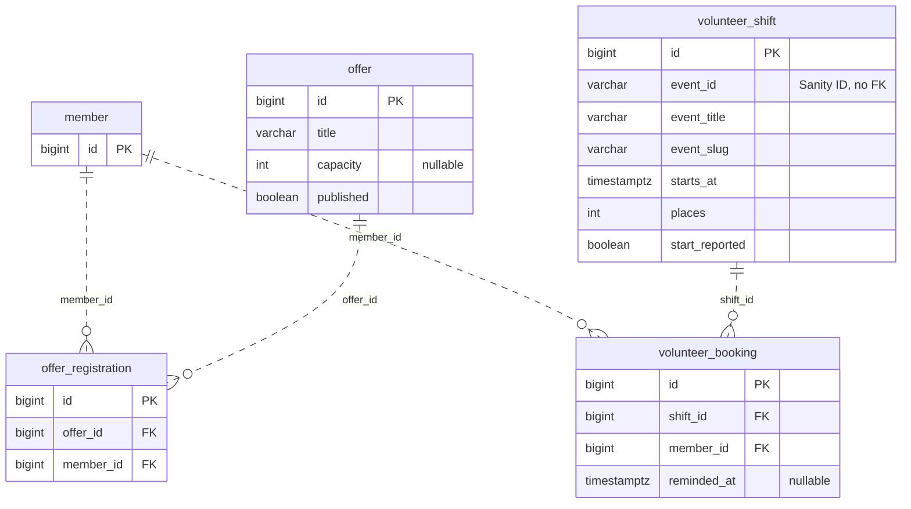
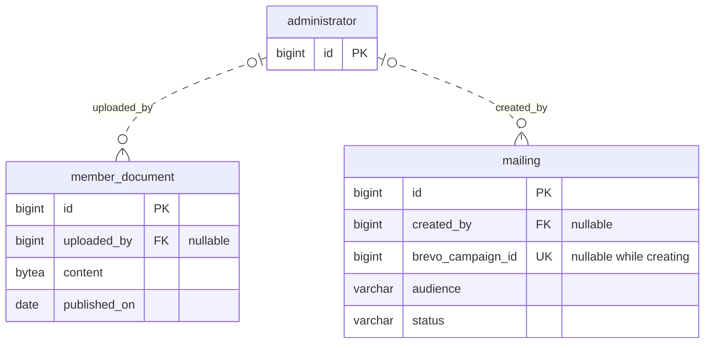
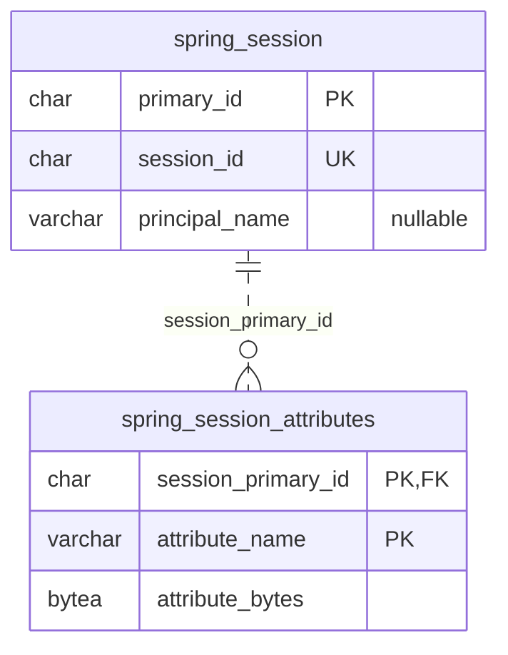

# Data model

[Architecture](../architecture.md) gives the runtime and code map. These diagrams describe the schema produced by [Flyway V1 through V18](../../src/main/resources/db/migration/) at [b7247ec](https://github.com/AlexanderReaper7/teaterihuskvarna/commit/b7247ecb138611c50bfe6a1cb7a55c40bd013ba6). All 20 application/framework tables appear in the diagrams or the standalone-table list. Flyway's own migration-history table is outside this model. Fields are selected keys and fields needed to understand a relationship, not a full column catalogue.

`||` means exactly one, `o|` means zero or one, and `o{` means zero or more. Each relationship names a database foreign-key column; the administrator loop combines two foreign keys with the same endpoints. Optionality follows nullability and uniqueness in SQL, not a desired business rule. Standalone tables have no database foreign keys.

## Members and accounts



A member is a person; an account is that person's login and email address. A household member can exist without an account. Administrator accounts are separate, and the same email address may appear in both account types. The two email indexes compare `LOWER(email)` within their respective tables.

## Fees and attribution

`member` and `household` repeat as reference points. The administrator loop names both columns that record who created or removed another administrator account.



The household's nullable `owner_member_id` means administrators manage it when no member owns it. SQL allows a member to own several households and does not require the owner to belong to that household; the service rules are stricter. A fee is unique on `(member_id, year)`, with amounts in integer öre. Fee status is computed, not a stored paid/unpaid column. A household fee retains `household_id` when its payer is deleted. See [ADR 0025 (Member register in the application)](../decisions/0025-member-register-in-the-application.md).

Deleting a member cascades to its account and invitation. Fee references to the member, household or marking administrator become null when the referenced row is deleted. Deleting a household owner sets the owner column to null; deleting a household with members still pointing to it is blocked by the foreign key. Removing an administrator normally marks the row with `removed_at`, preserving attribution.

## Offers and volunteer bookings

`member` repeats as a reference point.



The pairs `(offer_id, member_id)` and `(shift_id, member_id)` are unique. Deleting either parent cascades to its registrations or bookings. Services check capacity and deadlines inside transactions; an ER diagram alone says nothing about those checks.

A volunteer shift stores the published Sanity event ID plus a copy of its title and slug. There is no cross-system foreign key. Unpublishing an event does not delete its shifts.

## Documents and mailings



A member document stores its file in `BYTEA`, so a database dump includes it. Deleting an uploading administrator sets `uploaded_by` to null.

The mailing table stores the selected audience and Brevo's last reported status and counts. Its campaign ID refers to Brevo, not another database table. V13 removed the old recipient count and per-mailing list ID; V15 made the campaign ID nullable only while `status = 'creating'`. A partial unique index permits only one `creating` mailing at a time. The prepared HTML lives in Brevo. The [mailing flow](flows.md#mailing-preview-draft-and-send) explains recovery when Brevo's reply is lost.

## Login storage and pending work



The remaining six tables have no SQL foreign keys. Drawing relationships between them would imply constraints the database does not enforce.

| Table | Selected columns and purpose |
| --- | --- |
| `membership_application` | `id` primary key, case-insensitive unique `email`, unique `token_hash`, nullable `browser_hash`, `expires_at`. Pending contact details before confirmation. |
| `one_time_token` | `token_hash` primary key, `kind`, `email`, `browser_hash`, nullable `code_hash`, `code_tries`, `expires_at`. Browser-bound login links and codes. |
| `link_request` | `id` primary key, `email`, `client_address`, `requested_at`. Request history for rate limits. |
| `user_entities` | `id` primary key, `name`, `display_name`. Passkey owners keyed by Spring's principal names. |
| `user_credentials` | `credential_id` primary key, `user_entity_user_id`, `public_key`, signature count and metadata. Public credentials; even the owner association has no SQL foreign key. |
| `outbox` | `id` primary key, `kind`, text `payload`, `attempts`, `next_attempt_at`, nullable `not_after`. Work pending delivery to SMTP or Brevo. |

These tables use JDBC rather than domain JPA entities for tokens, request limits, sessions, passkeys and outbox work. Membership applications use a repository but stay outside the member register until confirmation. V18 adds the application's browser hash and permits a login token without a code. A pending application has no member/account foreign key.

`one_time_token.kind` distinguishes member and administrator login. Token and browser values are stored as SHA-256 hashes; the six-digit code has a hash too. A queued SMTP mail contains the actual link/code in its outbox payload until delivery or expiry, so a backup can contain an unexpired credential. The [outbox flow](flows.md#outbox-and-brevo-contacts) explains retry and `not_after` cleanup.

Spring Session's `principal_name` and the passkey owner's `user_entities.name` encode names such as `member:7` and `administrator:3`. The number identifies an account or administrator account, not a member row. Neither is a database foreign key. `user_credentials.user_entity_user_id` is also an application-managed association, without a SQL foreign key. [LoginRemovalRulesTest](../../src/test/java/se/teaterihuskvarna/architecture/LoginRemovalRulesTest.java) checks that login removal calls session and passkey cleanup.

The Brevo contact queue is not another table. V17's triggers add `kind = 'brevo-contact'` rows to `outbox`, carrying a member ID as text. SMTP mail uses `kind = 'mail'`. There is no foreign key from a payload to a member because contact deletion must still run after the member row has gone. See [ADR 0026 (Outbox and Brevo contacts)](../decisions/0026-outbox-and-brevo-contacts.md).

## Verification

Checked on 2026-11-11 against [b7247ec](https://github.com/AlexanderReaper7/teaterihuskvarna/commit/b7247ecb138611c50bfe6a1cb7a55c40bd013ba6).

All 18 migration files were applied in numeric order with `psql -v ON_ERROR_STOP=1` to an empty disposable PostgreSQL container using the pinned `postgres:18.6-alpine` image. No existing database was used. The result was `20 tables, 16 foreign keys`.

For all five ER diagrams and the standalone-table list, the check was a comparison with PostgreSQL's resulting catalogue, not a count of `CREATE TABLE` lines. Queries used were:

```sql
SELECT tablename FROM pg_tables
WHERE schemaname = 'public' ORDER BY tablename;

SELECT conrelid::regclass AS child, pg_get_constraintdef(oid)
FROM pg_constraint WHERE contype = 'f';

SELECT table_name, column_name, data_type, is_nullable
FROM information_schema.columns
WHERE table_schema = 'public' ORDER BY table_name, ordinal_position;

SELECT tablename, indexdef FROM pg_indexes
WHERE schemaname = 'public' ORDER BY tablename, indexname;
```

A one-off assertion compared the documented table names and foreign-key columns with the catalogue, including foreign-key nullability. It returned `Catalogue comparison passed: 20 tables, 16 foreign keys and FK optionality matched.` The diagrams repeat reference tables where needed. Selected columns, nullability and uniqueness matched the catalogue. The six contact-queue trigger tables were `member`, `account`, `fee`, `offer_registration`, `volunteer_booking` and `volunteer_shift`; [BrevoContactQueueIT](../../src/test/java/se/teaterihuskvarna/mailing/BrevoContactQueueIT.java) also checks trigger coverage for the tables read to build a contact.

[Flow verification](flows.md#verification) records rendering and behavioural checks. No committed check compares these ER diagrams with SQL. A proposed drift check would compare diagram table/foreign-key names, optionality and uniqueness with a database migrated from scratch; syntax checks alone cannot detect a stale ER diagram. This change adds no checker.
