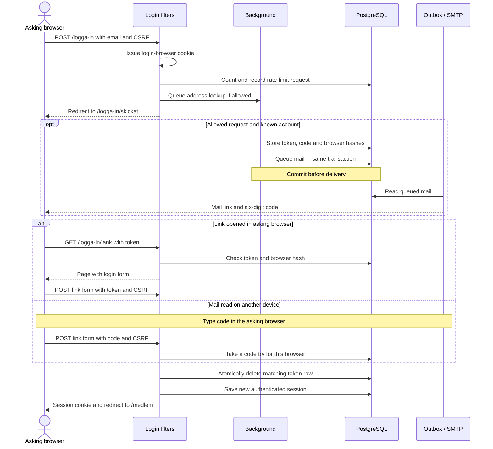
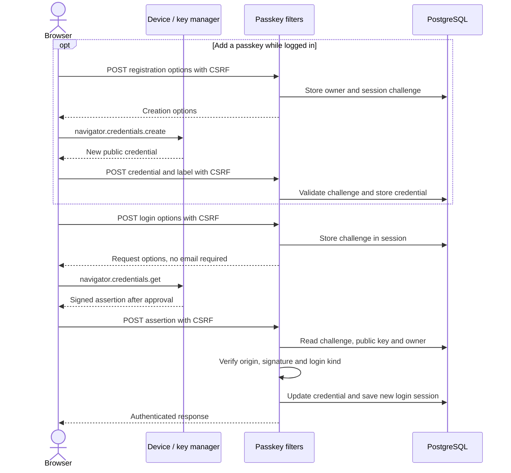
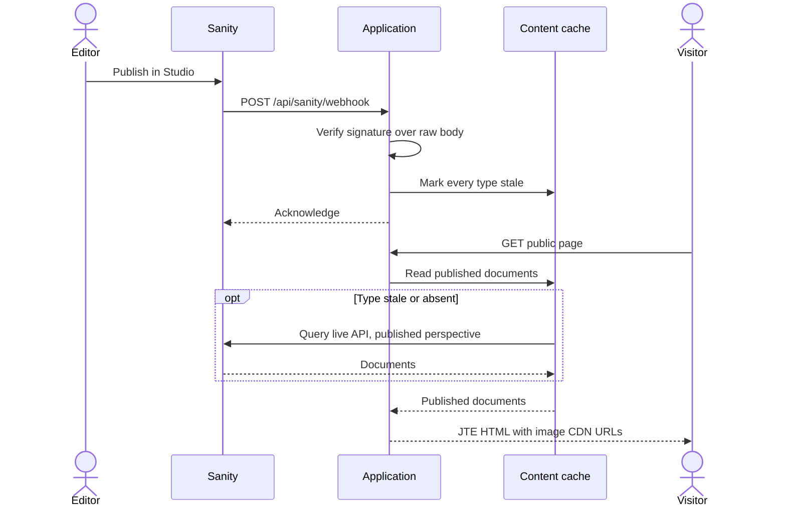
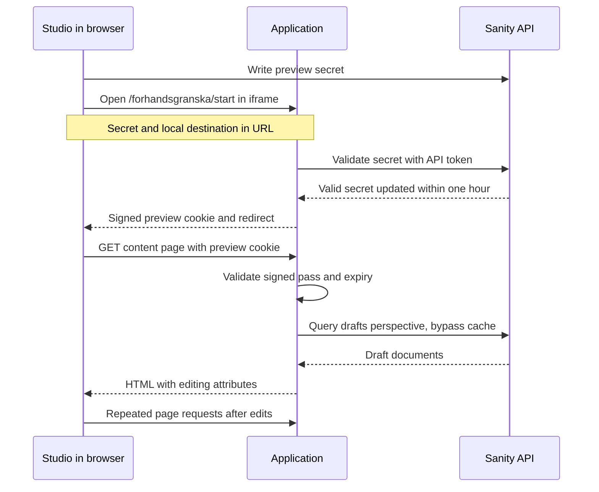
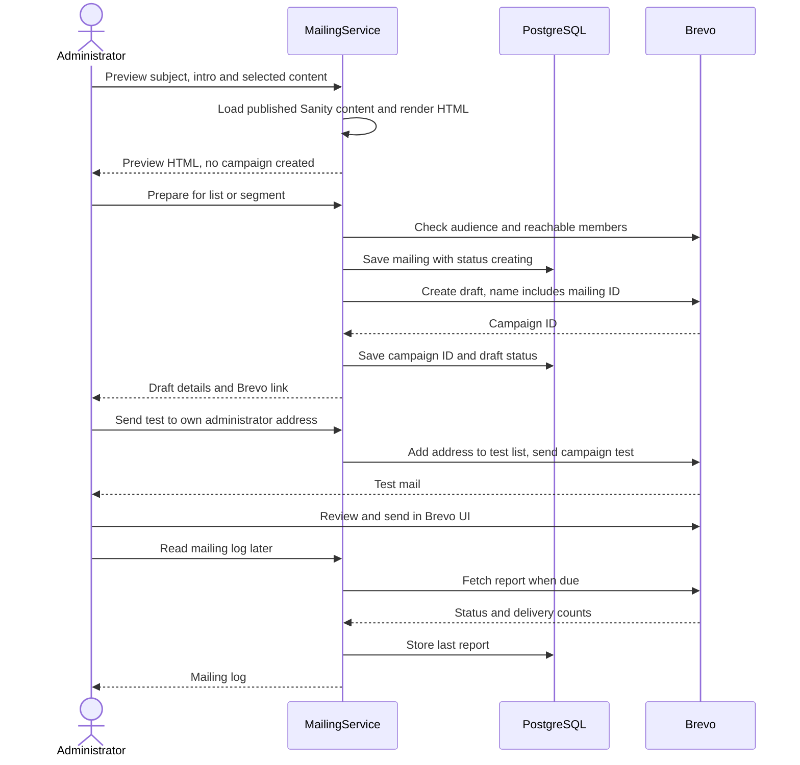
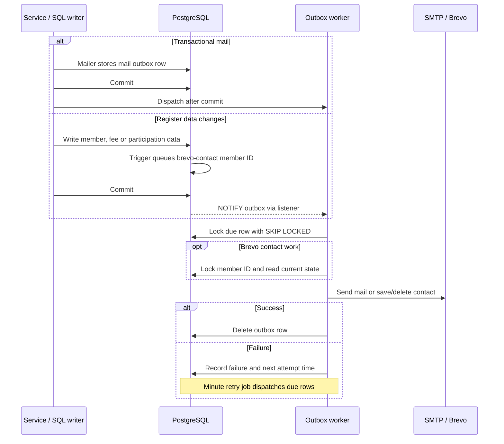
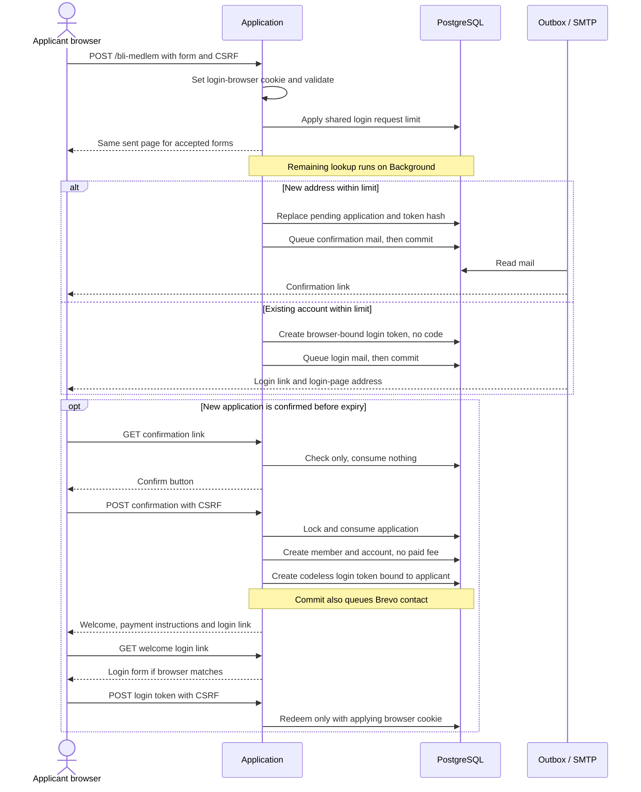

# Key flows

These sequences follow [main at b7247ec](https://github.com/AlexanderReaper7/teaterihuskvarna/commit/b7247ecb138611c50bfe6a1cb7a55c40bd013ba6), including V18. [Architecture](../architecture.md) gives the runtime and code map; [data model](data.md) names the stored records. Proxy hops and routine response headers are omitted here. Each application participant represents code inside the same Spring Boot process, not another service.

## Email-link login and the code for another device

Member paths start at `/logga-in`; administrator paths start at `/admin/logga-in`. Separate security chains use separate account lookups. The sequence shows the member paths. [SecurityConfiguration](../../src/main/java/se/teaterihuskvarna/login/SecurityConfiguration.java), [LoginLinks](../../src/main/java/se/teaterihuskvarna/login/LoginLinks.java) and [HashedTokenService](../../src/main/java/se/teaterihuskvarna/login/HashedTokenService.java) implement it. The reason for browser binding is in [ADR 0015 (Login links on Spring Security)](../decisions/0015-login-links-on-spring-security.md).



The success paths assume an unexpired token and the original browser cookie. Unknown addresses and requests over the limit produce the same sent page but no mail. [Background](../../src/main/java/se/teaterihuskvarna/login/Background.java) moves the address lookup, token insert and mail queuing off the request thread. That queue is in memory until the worker runs; durable delivery starts when the outbox row commits.

A GET never consumes a link. The link page's script submits its form, or the person presses its button. Opening the mail on another device does not transfer login to that device. The code must be entered on the sent page in the browser that asked. It allows five tries; exhausting them leaves the link usable. A successful code consumes the same row as the link. Older links remain valid until used or expired.

Defaults in [LoginSettings](../../src/main/java/se/teaterihuskvarna/login/LoginSettings.java) give links one hour, member logins 30 days and administrator logins eight hours. Login creates a new session row. [LoginExpiryFilter](../../src/main/java/se/teaterihuskvarna/login/LoginExpiryFilter.java) checks the fixed login end, and device controls can revoke sessions. HTML forms and REST mutations use CSRF protection; REST clients fetch a token from `/api/csrf` and send `X-CSRF-TOKEN`. The API uses the same session cookie.

## Passkeys

[PasskeyLogin](../../src/main/java/se/teaterihuskvarna/login/PasskeyLogin.java) configures Spring's WebAuthn filters. [PasskeyConfiguration](../../src/main/java/se/teaterihuskvarna/login/PasskeyConfiguration.java) supplies the JDBC stores and site origin; [PasskeyAuthenticationProvider](../../src/main/java/se/teaterihuskvarna/login/PasskeyAuthenticationProvider.java) checks the login kind and active owner. See [ADR 0016 (Passkeys beside links)](../decisions/0016-passkeys-beside-links.md).



The private key stays with the authenticator; the application stores the public credential. Member registration paths are under `/medlem/passkeys`, login paths under `/logga-in/passkey`. Administrator paths use their own `/admin` equivalents. [PasskeyUrls](../../src/main/java/se/teaterihuskvarna/login/PasskeyUrls.java) lists all four paths per kind. A member credential cannot authenticate on the administrator login page. The relying-party ID comes from the configured site's hostname, so changing that hostname requires people to add passkeys again. Email-link login remains available.

## Published content

[ContentController](../../src/main/java/se/teaterihuskvarna/api/ContentController.java) receives the webhook. [ContentService](../../src/main/java/se/teaterihuskvarna/content/ContentService.java), [ContentCache](../../src/main/java/se/teaterihuskvarna/content/ContentCache.java) and [SanityContentSource](../../src/main/java/se/teaterihuskvarna/content/SanityContentSource.java) implement fetching. [ADR 0021 (Content from Sanity)](../decisions/0021-content-from-sanity.md) records the choice.



The webhook invalidates copies; it does not push content into PostgreSQL or rebuild the application. The next request fetches what it needs. The cache holds each published document type for 45 seconds by default and uses the live query API rather than Sanity's query CDN. A missing webhook therefore falls back to age-based fetching. Sanity must be configured to send the webhook, as described in [Studio instructions](../../studio/README.md).

During a fetch, concurrent requests get the last copy if one exists. A failed fetch also preserves that copy and backs off for 10 seconds. Without any copy, the first requests share the fetch and a failure becomes `ContentUnavailable`. Repeated upstream failures can leave stale content visible for longer than 45 seconds. A signature failure does not invalidate anything.

## Draft preview



[studio/sanity.config.ts](../../studio/sanity.config.ts) configures the entry and exit paths. [PreviewController](../../src/main/java/se/teaterihuskvarna/web/PreviewController.java) exchanges the Studio secret through [Previews](../../src/main/java/se/teaterihuskvarna/content/Previews.java), sets the cookie and restricts redirects to local paths. The pass lasts one hour. Its signing key exists only in application memory; restart ends all previews.

The cookie is `HttpOnly; Secure; SameSite=None; Partitioned`, so the cross-site iframe needs HTTPS. In browsers that support partitioned cookies, a Studio on a different top-level site has a separate preview cookie from direct site visits. The shared `/studio` route uses the same site, so that separation does not apply there. This follows the [top-level-site partition key](https://privacysandbox.google.com/cookies/chips#what-is-chips), rather than a separate application login check. Public page responses permit the configured Studio origin to frame them; member pages do not. Draft queries require `SANITY_API_KEY`. [ContentPageController](../../src/main/java/se/teaterihuskvarna/web/ContentPageController.java) uses the pass to select drafts. Preview pages load [visual-editing/main.js](../../visual-editing/main.js) for Studio communication and refresh; drafts never enter the published cache. The REST preview endpoint returns a pass used in `Preview-Pass` instead of this cookie.

## Mailing preview, draft and send

[MailingService](../../src/main/java/se/teaterihuskvarna/mailing/MailingService.java) prepares mailings. [HttpBrevo](../../src/main/java/se/teaterihuskvarna/mailing/HttpBrevo.java) performs API calls. [AdministratorMailingPageController](../../src/main/java/se/teaterihuskvarna/web/AdministratorMailingPageController.java) and [AdministratorMailingsController](../../src/main/java/se/teaterihuskvarna/api/AdministratorMailingsController.java) call the same service methods. See [ADR 0026 (Outbox and Brevo contacts)](../decisions/0026-outbox-and-brevo-contacts.md).



A mailing uses the shared members' list or a segment saved in Brevo. Preparation refuses an empty audience or a segment containing contacts outside the members' list. It checks Brevo's state at preparation time; Brevo may change before the send. The test recipient comes from the logged-in administrator, and a separate test list holds that address. Preview HTML uses a sandboxed frame. Brevo owns the actual bulk send and unsubscribes; the application has no bulk-send endpoint.

Campaign creation is synchronous and uses the mailing table for recovery, not the outbox. No database transaction stays open across its Brevo call. If the reply is lost, the service immediately looks for the campaign by its name, which includes the mailing ID. It returns the recovered draft if found. Otherwise the row remains `creating`, and reading the log or preparing another mailing repeats the lookup. Another draft is blocked while one remains unresolved. A definitive Brevo refusal removes the attempt; an attempt still not found after five minutes is removed on a later reconciliation. This is not an independent background timer.

A successful report suppresses another refresh for one minute. An overdue campaign whose refresh fails stays due, so another log read can try again immediately; the log shows its last stored report. Development's fake Brevo cannot prove that a real message arrives or that an administrator sends a campaign in the real Brevo UI.

## Outbox and Brevo contacts



[Mailer](../../src/main/java/se/teaterihuskvarna/login/Mailer.java) and [MailDelivery](../../src/main/java/se/teaterihuskvarna/login/MailDelivery.java) handle SMTP work. [Outbox](../../src/main/java/se/teaterihuskvarna/outbox/Outbox.java) runs one worker per kind, so a slow Brevo call does not block the mail worker. A delivery attempt holds its database row lock and transaction while calling the other system. This differs from campaign creation above.

[V17](../../src/main/resources/db/migration/V17__brevo_contact_queue.sql) queues contact updates on writes to six tables. It deduplicates each member within a transaction. [OutboxNotifications](../../src/main/java/se/teaterihuskvarna/outbox/OutboxNotifications.java) listens on a separate PostgreSQL connection and dispatches after committed notifications. The minute retry job also finds due rows if a notification is missed. [BrevoContacts](../../src/main/java/se/teaterihuskvarna/mailing/BrevoContacts.java) reads current state after taking an advisory lock for that member ID. It saves the contact's name, email, `PAID_YEAR`, `LAST_SHIFT` and `OFFERS`, or deletes the contact when the member/account is gone. Brevo's external contact ID is the member ID. Synchronization preserves an existing unsubscribe.

Failures double the wait from one minute up to six hours. Work without `not_after` keeps retrying, including after ten failures when an error is logged. Expiring mail carries `not_after` equal to its useful lifetime. A worker checks that before calling SMTP, and the minute job deletes expired work without sending it. The diagram shows the unexpired path. A delivery already in progress can finish after the deadline.

Delivery can repeat if an external call succeeds and the process dies before the transaction deletes its row. Row locks prevent concurrent attempts for the same row; they cannot make an SMTP send and a database commit atomic. Contact writes use the member's current state, so a retry does not replay stale attributes.

## Bli medlem application

[MembershipApplicationService](../../src/main/java/se/teaterihuskvarna/member/MembershipApplicationService.java) implements the application. [MembershipApplicationPageController](../../src/main/java/se/teaterihuskvarna/web/MembershipApplicationPageController.java) handles the form and confirmation page. The account/member distinction is in the [glossary](../../GLOSSARY.md#membership-application--ansökan-om-medlemskap).



The initial form creates no member or account. It stores contact details in a pending application, which expires after 24 hours and is removed by [ExpiredApplications](../../src/main/java/se/teaterihuskvarna/member/ExpiredApplications.java). Confirmation works in any browser, once, while valid. It creates one member and one account, without a paid fee or household. A member can manage a household afterwards.

The welcome page links to the login-link page, whose form the script submits. Its token is bound to the browser that submitted the original application, not whichever browser opens the confirmation. In another browser, that token leads to the login page instead. An application without a browser hash confirms without a login token. An existing account gets the browser-bound login link instead of a new membership application; without a browser hash, its mail contains only the login-page address. Both cases use the same visible sent response. These paths are implemented on the documented main commit, independently of branch `214-logging-in-page`.

## Verification

Checked on 2026-11-11 against [b7247ec](https://github.com/AlexanderReaper7/teaterihuskvarna/commit/b7247ecb138611c50bfe6a1cb7a55c40bd013ba6). Each row names the existing behavioural checks used to compare the sequence with code.

| Diagram | Existing checks |
| --- | --- |
| Email-link login and code | [LoginIT](../../src/test/java/se/teaterihuskvarna/login/LoginIT.java) checks identical known/unknown responses, browser binding, code limits, GET versus POST, expiry and one-time use. [SessionStoreIT](../../src/test/java/se/teaterihuskvarna/login/SessionStoreIT.java) checks persisted session reading. |
| Passkeys | [PasskeyIT](../../src/test/java/se/teaterihuskvarna/login/PasskeyIT.java) registers credentials, authenticates signed challenges and refuses the other login kind. |
| Published content | [ContentIT](../../src/test/java/se/teaterihuskvarna/content/ContentIT.java) checks pages and webhook signatures; [ContentCacheTest](../../src/test/java/se/teaterihuskvarna/content/ContentCacheTest.java) checks age, invalidation, concurrent reads and failure fallback. [SanityContentSourceTest](../../src/test/java/se/teaterihuskvarna/content/SanityContentSourceTest.java) checks query requests. |
| Draft preview | [ContentPreviewApiIT](../../src/test/java/se/teaterihuskvarna/content/ContentPreviewApiIT.java) and [PreviewEditingIT](../../src/test/java/se/teaterihuskvarna/content/PreviewEditingIT.java) check secret exchange, preview isolation, editing markup and headers. The refresh arrows were also traced through the Studio configuration and browser script linked above. |
| Mailing preview, draft and send | [MailingIT](../../src/test/java/se/teaterihuskvarna/mailing/MailingIT.java) checks preview, audience validation, draft recovery, test recipient and reports. [HttpBrevoTest](../../src/test/java/se/teaterihuskvarna/mailing/HttpBrevoTest.java) checks HTTP requests, including contact suppression. Actual sending in Brevo's UI is outside these checks. |
| Outbox and contacts | [OutboxIT](../../src/test/java/se/teaterihuskvarna/outbox/OutboxIT.java), [OutboxNotificationsIT](../../src/test/java/se/teaterihuskvarna/outbox/OutboxNotificationsIT.java), [BrevoContactQueueIT](../../src/test/java/se/teaterihuskvarna/mailing/BrevoContactQueueIT.java) and [BrevoContactsIT](../../src/test/java/se/teaterihuskvarna/mailing/BrevoContactsIT.java) check commit/rollback, expiry, retries, reconnect, SQL triggers and contact updates. |
| Bli medlem | [MembershipApplicationIT](../../src/test/java/se/teaterihuskvarna/member/MembershipApplicationIT.java) checks application storage, confirmation, browser-bound welcome login, existing-account mail, expiry and shared request limits. |

The focused command also runs the code-map rules from [architecture](../architecture.md#verification):

```sh
sh scripts/maven.sh '-Dtest=AdapterRulesTest,ServiceRulesTest,DevelopmentRulesTest,LoginRemovalRulesTest,LoginIT,PasskeyIT,SessionStoreIT,ContentCacheTest,ContentIT,ContentPreviewApiIT,PreviewEditingIT,SanityContentSourceTest,MailingIT,HttpBrevoTest,BrevoContactQueueIT,BrevoContactsIT,OutboxIT,OutboxNotificationsIT,MembershipApplicationIT' verify
```

The focused Docker run returned `BUILD SUCCESS`: 205 tests in 19 classes, with 0 failures, 0 errors and 0 skipped. It also passed Checkstyle, SpotBugs and PMD. This was a focused verification, not the full Java suite.

All 16 new Mermaid diagrams were rendered with `mmdc` 11.17.0 and inspected as PNGs at a 900 px viewport. The production connections and ER diagrams were split after the initial renders made labels too small. The render command for each extracted block was:

```sh
mmdc -i diagram.mmd -o diagram.png -p puppeteer.json -w 900 -q
```

The temporary Puppeteer configuration set `args` to `["--no-sandbox"]`, as the repository checker does. Rendered PNGs and temporary comparison scripts are review aids, not repository files. The committed output is Mermaid in Markdown.

The documentation workflow command, `python3 docs/check.py --require-mermaid`, passed. Its result included `25 requirements quoted intact`, `all relative links resolve`, `everything that can be a link is one` and `26 mermaid diagrams parse`. The count includes 10 diagrams already in the repository. CI uses mmdc 11.17.1, pinned in the [docs workflow](../../.github/workflows/docs.yml); the local render used the installed 11.17.0.

These tests exercise the application with test PostgreSQL and controlled Sanity/Brevo/SMTP substitutes. They do not parse or compare the sequence diagrams. An arrow can therefore drift while CI stays green. A proposed check would maintain scenario assertions for the named milestones and compare diagram participant/method references with source; manual review would still be needed for ordering and omitted steps. No new checker is added. No live Sanity publication, real Brevo send, real SMTP delivery, browser end-to-end run or production deployment was performed for this documentation change.
