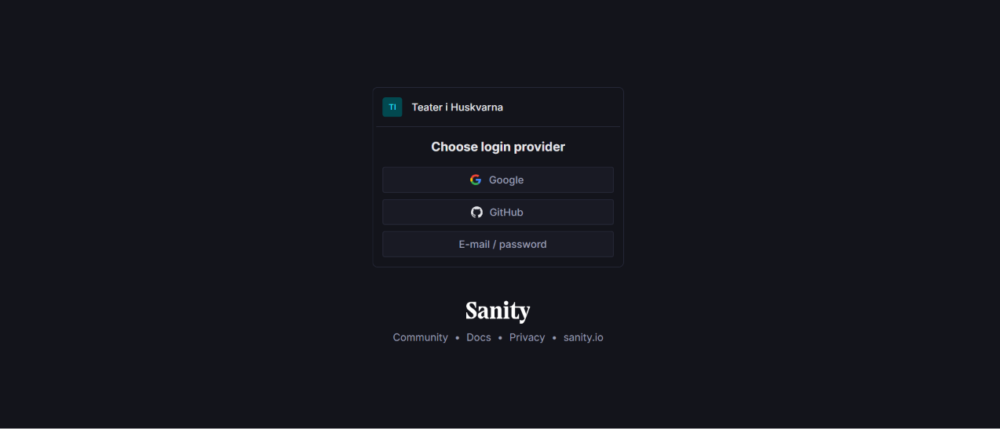
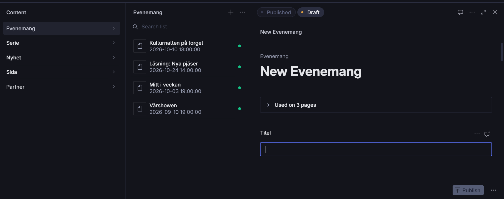
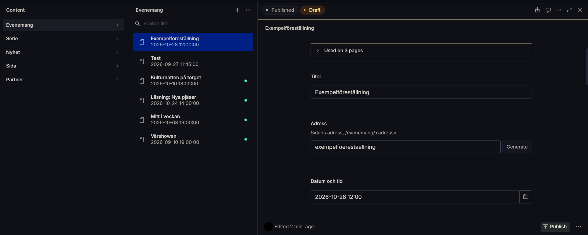
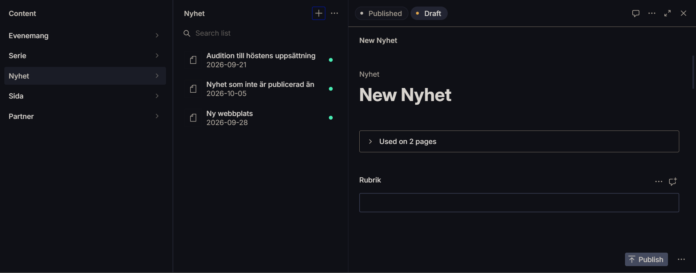
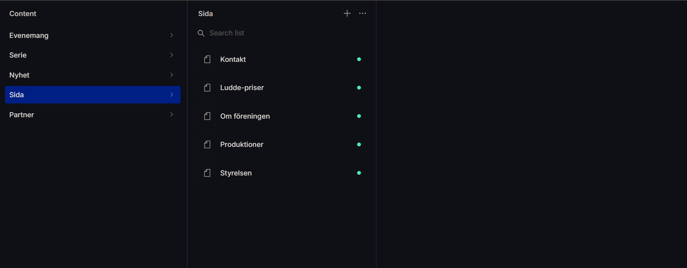
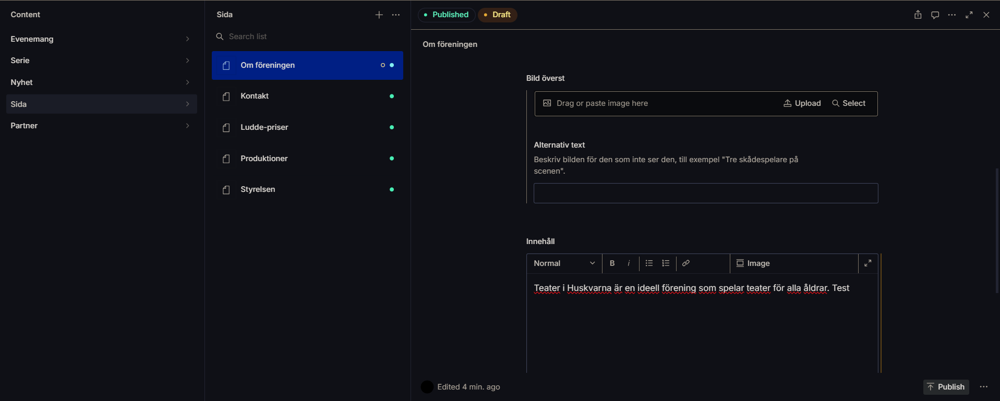
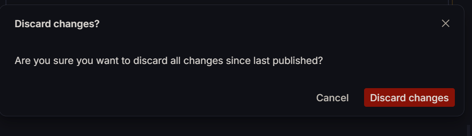

# Redaktörsguide för Sanity Studio

Den här guiden är till för föreningens redaktörer. Den är skriven på svenska av samma skäl, se [decisions/0001](decisions/0001-language-policy.md).

## Logga in
Innan du kan logga in måste du ha blivit inbjuden till Sanity-projektet. Be en administratör bjuda in dig.

1. Öppna Studio i webbläsaren. Adressen är: *adress läggs till när den publicerade Studion finns*.
2. Välj hur du vill logga in: **GitHub**, **Google** eller **E-mail / password**.

   

3. Om du väljer e-post och det är första gången, skickar Sanity en kod med fyra siffror till din e-postadress. Skriv in koden. Du behöver bara göra det en gång.
4. När du är inloggad ser du listan **Content** till vänster med Evenemang, Serie, Nyhet, Sida och Partner.

## Skapa och publicera ett evenemang
1. Klicka på **Evenemang** i listan **Content** till vänster.
2. Klicka på plustecknet (**+**) högst upp i den mittersta kolumnen. Ett nytt, tomt formulär öppnas till höger.

   

3. Fyll i fälten uppifrån och ned. Formuläret är längre än fönstret, så **rulla nedåt** med musen för att se alla fält.

   | Fält | Vad du gör |
   |------|------------|
   | **Titel** | Skriv evenemangets namn. |
   | **Adress** | Klicka på **Generate** så skapas adressen av titeln. Hela adressen blir till exempel `/evenemang/exempelfoerestaellning`. Å, ä och ö ersätts med andra bokstäver, och det är normalt. |
   | **Datum och tid** | Välj när evenemanget börjar. | 
   | **Plats** | Skriv var evenemanget hålls. | 
   | **Serie** | Välj serie om evenemanget hör till en, till exempel Kaffe med drömmar. Lämna tomt för ett fristående evenemang. | 
   | **Ingress** | Skriv en eller två meningar. De visas i kalendern och på startsidan. | 
   | **Huvudbild** | Dra en bild hit eller klistra in den. Bilden visas överst på evenemangets sida och i kalendern. | 
   | **Alternativ text** | Beskriv bilden för den som inte ser den, till exempel "Tre skådespelare på scenen". | 
   | **Beskrivning** | Skriv en längre text om evenemanget. | 
   | **Bildgalleri** | Lägg till fler bilder, till exempel från repetitioner. | 
   | **Länk till biljetter** | Klistra in länken där man köper biljetter. | 

   Du måste fylla i **Titel**, **Adress** och **Datum och tid** för att kunna publicera.

   Om ett obligatoriskt fält är tomt går det inte att publicera. Fältet får en röd ram och ett rött utropstecken. Fyll i fältet och klicka på **Publish** igen.

4. Klicka på knappen **Publish** längst ned till höger.

   

5. Kontrollera att fliken **Published** nu är markerad högst upp. Då är evenemanget publicerat och syns på webbplatsen inom en minut.

## Skapa och publicera en nyhet
1. Klicka på **Nyhet** i listan **Content** till vänster.
2. Klicka på plustecknet (**+**) högst upp i den mittersta kolumnen. Ett nytt, tomt formulär öppnas till höger.

   

3. Fyll i fälten uppifrån och ned. Formuläret är längre än fönstret, så **rulla nedåt** med musen för att se alla fält.
   
   | Fält | Vad du gör |
   |------|------------|
   | **Rubrik** | Skriv nyhetens rubrik. |
   | **Adress** | Klicka på **Generate** så skapas adressen av rubriken. |
   | **Publiceringsdatum** | Välj datum och tid då nyheten ska börja synas på webbplatsen. |
   | **Ingress** | Skriv en kort inledning. |
   | **Huvudbild** | Dra en bild hit eller klistra in den. |
   | **Alternativ text** | Beskriv bilden för den som inte ser den. |
   | **Brödtext** | Skriv själva nyheten. |
   | **Video** | Klistra in en länk till YouTube eller Vimeo. Lämna tomt om du inte har någon. |

   Du måste fylla i **Rubrik** och **Adress** för att kunna publicera.

   Om ett obligatoriskt fält är tomt går det inte att publicera. Fältet får en röd ram och ett rött utropstecken. Fyll i fältet och klicka på **Publish** igen.

4. Klicka på knappen **Publish** längst ned till höger.
5. Kontrollera att fliken **Published** nu är markerad högst upp. Då är nyheten publicerad och syns på webbplatsen inom en minut.

## Redigera en fast sida
De fasta sidorna är **Om föreningen**, **Styrelsen**, **Produktioner**, **Ludde-priser** och **Kontakt**. Du ändrar texten på dem, men skapar inga nya sidor.

1. Klicka på **Sida** i listan **Content** till vänster. De fasta sidorna visas i mittenkolumnen.

   

2. Klicka på den sida du vill ändra. Formuläret öppnas till höger.
3. Ändra det du vill i formuläret. Det är längre än fönstret, så **rulla nedåt** för att se alla fält.

   | Fält | Vad du gör |
      |------|------------|
   | **Rubrik** | Ändra inte. Webbplatsen använder den för att hitta rätt sida. |
   | **Vilken sida** | Ändra inte. Det finns bara fem sidor, och adressen måste vara en av dem. |
   | **Bild överst** | Dra en bild hit eller klistra in den. Du kan också klicka på **Upload** för att välja en bild från datorn, eller **Select** för att välja en bild som redan finns. |
   | **Alternativ text** | Beskriv bilden för den som inte ser den, till exempel "Tre skådespelare på scenen". |
   | **Innehåll** | Skriv eller ändra sidans text. Verktygsraden ovanför texten har bland annat fet stil, kursiv, punktlista, numrerad lista och länk. |

   

4. Klicka på knappen **Publish** längst ned till höger när du är nöjd.
5. Kontrollera att fliken **Published** är markerad högst upp. Ändringen syns på webbplatsen inom en minut.

### Om du ångrar dig innan du har publicerat
Du kan kasta alla ändringar du har gjort sedan sidan senast publicerades.

1. Klicka på de tre prickarna (**...**) bredvid **Publish**.
2. Välj **Discard changes**.
3. Klicka på den röda knappen **Discard changes** för att bekräfta. Tryck på **Cancel** om du ångrar dig.

   

## Lägg till eller ändra en partner

## Förhandsgranska ett utkast

## Avpublicera, ta bort och ångra

## Bilder

## Hur lång tid tar det innan ändringen syns?

## Vem kontaktar du om något går fel?