# Redaktörsguide för Sanity Studio

Den här guiden är till för föreningens redaktörer. Den är skriven på svenska av samma skäl, se [decisions/0001](decisions/0001-language-policy.md).

## Logga in
Innan du kan logga in måste du ha blivit inbjuden till Sanity-projektet. Be en administratör bjuda in dig.

1. Öppna Studio i webbläsaren. Adressen är: *adress läggs till när den publicerade Studion finns*.
2. Välj hur du vill logga in: **GitHub**, **Google** eller **E-mail / password**.

   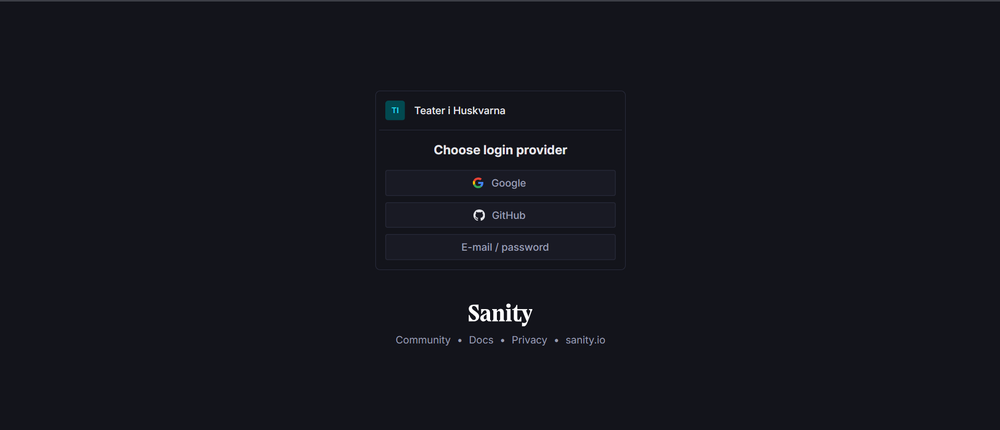

3. Om du väljer e-post och det är första gången, skickar Sanity en kod med fyra siffror till din e-postadress. Skriv in koden. Du behöver bara göra det en gång.
4. När du är inloggad ser du listan **Innehåll** till vänster med Evenemang, Nyheter, Serier, Sidor, Produktioner, Styrelsen, Ludde-priser och Partners.

## Skapa och publicera ett evenemang
1. Klicka på **Evenemang** i listan **Innehåll** till vänster och sedan på **Kommande evenemang**. Där visas evenemangen som inte har hänt än.
2. Klicka på plustecknet (**+**) högst upp i den mittersta kolumnen. Ett nytt, tomt formulär öppnas till höger.

   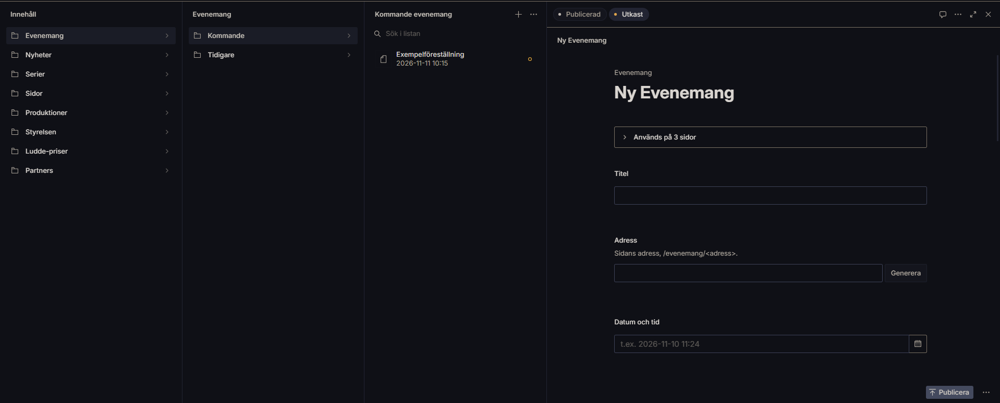

3. Fyll i fälten uppifrån och ned. Formuläret är längre än fönstret, så **rulla nedåt** med musen för att se alla fält.

   | Fält | Vad du gör                                                                                                                                                                                     |
      |------|------------------------------------------------------------------------------------------------------------------------------------------------------------------------------------------------|
   | **Titel** | Skriv evenemangets namn.                                                                                                                                                                       |
   | **Adress** | Klicka på **Generera** så skapas adressen av titeln. Hela adressen blir till exempel `/evenemang/exempelfoerestaellning`. Å, ä och ö ersätts med andra bokstäver, och det är normalt.          |
   | **Datum och tid** | Välj när evenemanget börjar.                                                                                                                                                                   |
   | **Plats** | Skriv var evenemanget hålls.                                                                                                                                                                   |
   | **Serie** | Skriv i fältet för att söka efter serien och välj den, till exempel Kaffe med drömmar. Du kan också klicka på **Skapa ny** för att skapa en ny serie. Lämna tomt för ett fristående evenemang. |
   | **Ingress** | Skriv en eller två meningar. De visas i kalendern och på startsidan.                                                                                                                           |
   | **Huvudbild** | Klicka på **Ladda upp** för att välja en bild från datorn, eller dra eller klistra in en bild. Bilden visas överst på evenemangets sida och i kalendern.                                       |
   | **Alternativ text** | Beskriv bilden för den som inte ser den, till exempel "Tre skådespelare på scenen". Du måste fylla i den när du har lagt till en bild.                                                         |
   | **Beskrivning** | Skriv en längre text om evenemanget.                                                                                                                                                           |
   | **Bildgalleri** | Lägg till fler bilder, till exempel från repetitioner.                                                                                                                                         |
   | **Länk till biljetter** | Klistra in länken där man köper biljetter.                                                                                                                                                     |

   Du måste fylla i **Titel**, **Adress** och **Datum och tid** för att kunna publicera.

   Om ett obligatoriskt fält är tomt går det inte att publicera. Fältet får en röd ram och ett rött utropstecken, och över knappen **Publicera** står "Det finns valideringsfel som måste åtgärdas innan detta dokument kan publiceras". Fyll i fältet och klicka på **Publicera** igen.

4. Klicka på knappen **Publicera** längst ned till höger.

   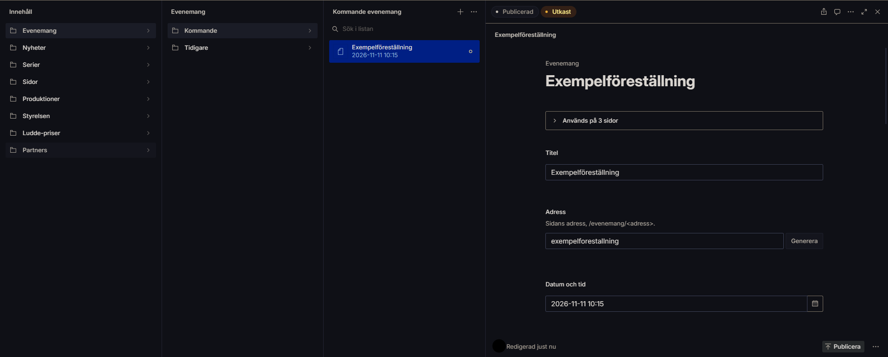

5. Kontrollera att fliken **Publicerad** nu är markerad högst upp. Då är evenemanget publicerat och syns på webbplatsen inom en minut.

## Skapa och publicera en nyhet
1. Klicka på **Nyheter** i listan **Innehåll** till vänster.
2. Klicka på plustecknet (**+**) högst upp i den mittersta kolumnen. Ett nytt, tomt formulär öppnas till höger.

   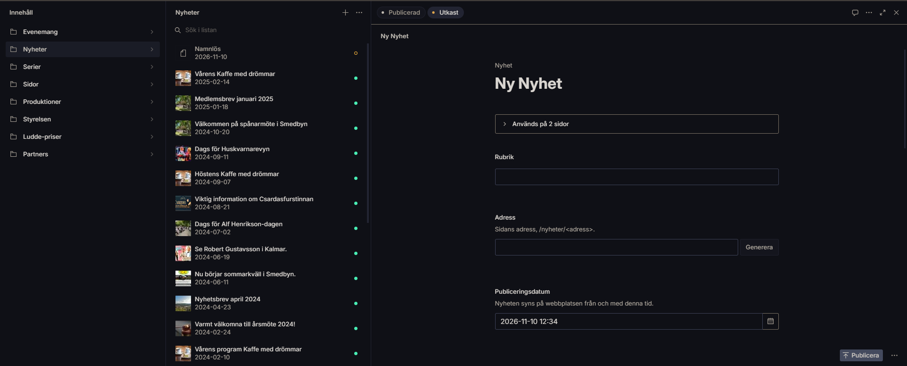

3. Fyll i fälten uppifrån och ned. Formuläret är längre än fönstret, så **rulla nedåt** med musen för att se alla fält.

   | Fält | Vad du gör                                                                                     |
      |------|------------------------------------------------------------------------------------------------|
   | **Rubrik** | Skriv nyhetens rubrik.                                                                         |
   | **Adress** | Klicka på **Generera** så skapas adressen av rubriken.                                         |
   | **Publiceringsdatum** | Välj datum och tid då nyheten ska börja synas på webbplatsen.                                  |
   | **Ingress** | Skriv en kort inledning.                                                                       |
   | **Huvudbild** | Klicka på **Ladda upp** för att välja en bild från datorn, eller dra eller klistra in en bild. |
   | **Alternativ text** | Beskriv bilden för den som inte ser den. Du måste fylla i den när du har lagt till en bild.    |
   | **Brödtext** | Skriv själva nyheten.                                                                          |
   | **Video** | Klistra in en länk till YouTube eller Vimeo. Lämna tomt om du inte har någon.                  |

   Du måste fylla i **Rubrik** och **Adress** för att kunna publicera.

   Om ett obligatoriskt fält är tomt går det inte att publicera. Fältet får en röd ram och ett rött utropstecken, och över knappen **Publicera** står "Det finns valideringsfel som måste åtgärdas innan detta dokument kan publiceras". Fyll i fältet och klicka på **Publicera** igen.

4. Klicka på knappen **Publicera** längst ned till höger.
5. Kontrollera att fliken **Publicerad** nu är markerad högst upp. Då är nyheten publicerad och syns på webbplatsen inom en minut.

## Redigera en fast sida
De fasta sidorna är **Om föreningen**, **Styrelsen**, **Produktioner**, **Ludde-priser** och **Kontakt**. Du ändrar texten på dem, men skapar inga nya sidor.

1. Klicka på **Sidor** i listan **Innehåll** till vänster. De fasta sidorna visas i mittenkolumnen.

   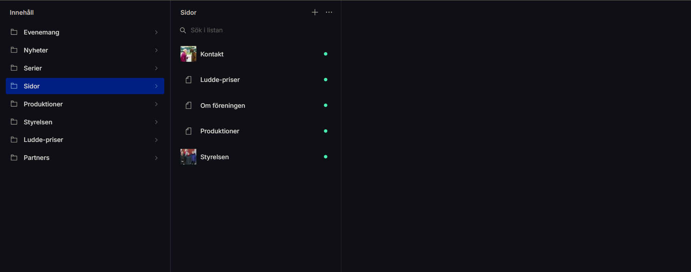

2. Klicka på den sida du vill ändra. Formuläret öppnas till höger.
3. Ändra det du vill i formuläret. Det är längre än fönstret, så **rulla nedåt** för att se alla fält.

   | Fält | Vad du gör |
      |------|------------|
   | **Rubrik** | Ändra inte. Webbplatsen använder den för att hitta rätt sida. |
   | **Vilken sida** | Ändra inte. Det finns bara fem sidor, och adressen måste vara en av dem. |
   | **Bild överst** | Klicka på **Ladda upp** för att välja en bild från datorn, eller **Välj** för att välja en bild som redan finns. Du kan också dra eller klistra in en bild. |
   | **Alternativ text** | Beskriv bilden för den som inte ser den, till exempel "Tre skådespelare på scenen". Du måste fylla i den när du har lagt till en bild. |
   | **Innehåll** | Skriv eller ändra sidans text. Verktygsraden ovanför texten har bland annat fet stil, kursiv, punktlista, numrerad lista och länk. |

   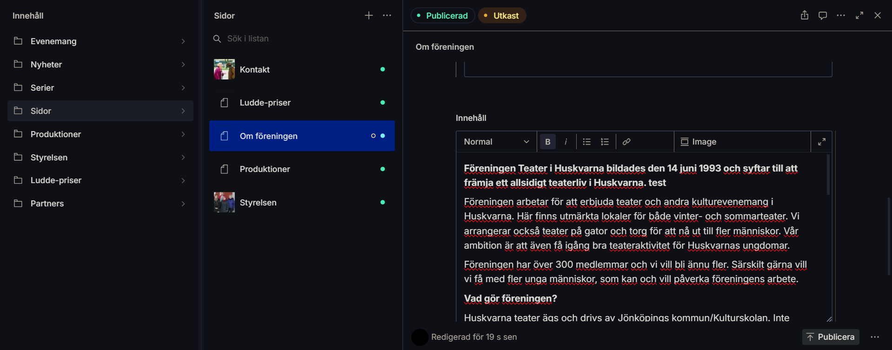

4. Klicka på knappen **Publicera** längst ned till höger när du är nöjd.
5. Kontrollera att fliken **Publicerad** är markerad högst upp. Ändringen syns på webbplatsen inom en minut.

Har du ändrat något som du inte vill publicera kan du kassera ändringarna. Det beskrivs i avsnittet **Avpublicera, ta bort och ångra** längre ned.

## Lägg till eller ändra en partner
Partnerna visas på sidan `/partners` på webbplatsen.

### Lägg till en ny partner

1. Klicka på **Partners** i listan **Innehåll** till vänster. De partners som finns visas i mittenkolumnen.
2. Klicka på plustecknet (**+**) högst upp i den mittersta kolumnen. Ett nytt, tomt formulär öppnas till höger.

   Formuläret kan också visas över hela fönstret.

   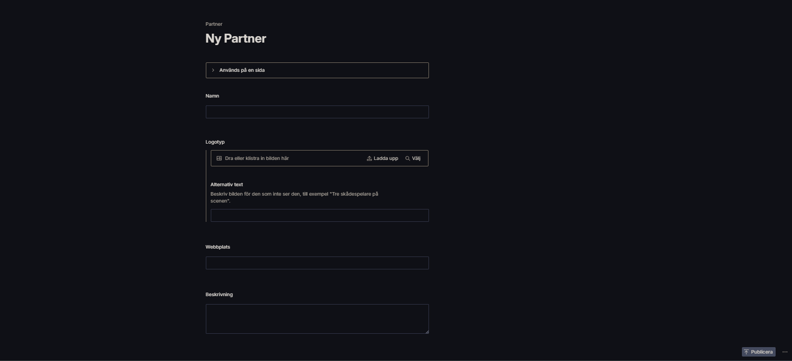

3. Fyll i fälten uppifrån och ned.

   | Fält | Vad du gör |
      |------|------------|
   | **Namn** | Skriv partnerns namn. |
   | **Logotyp** | Klicka på **Ladda upp** för att välja en bild från datorn, eller **Välj** för att välja en bild som redan finns. Du kan också dra eller klistra in en bild. |
   | **Alternativ text** | Beskriv bilden för den som inte ser den, till exempel "Logotyp för Exempelpartner". Du måste fylla i den när du har lagt till en bild. |
   | **Webbplats** | Skriv partnerns hela webbadress. Den måste börja med `https://` eller `http://`. |
   | **Beskrivning** | Skriv en kort text om partnern. |

   Du måste bara fylla i **Namn** för att kunna publicera.

   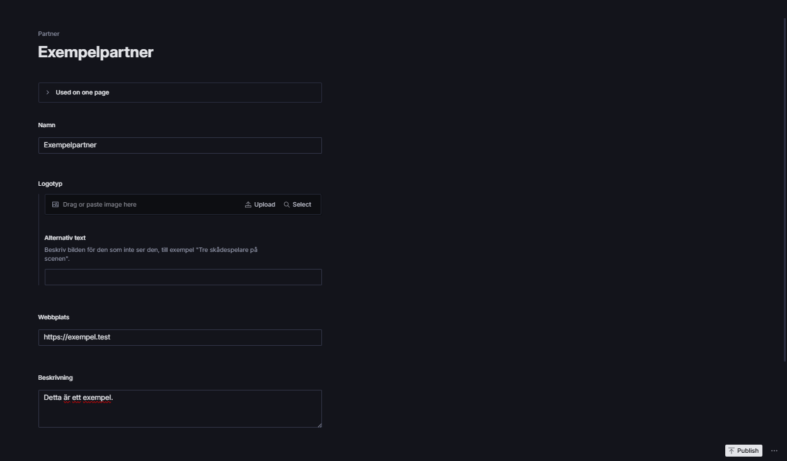

4. Klicka på knappen **Publicera** längst ned till höger.
5. Kontrollera att fliken **Publicerad** nu är markerad högst upp. Partnern syns på webbplatsen inom en minut.

### Ändra en partner som redan finns

1. Klicka på **Partners** i listan **Innehåll** till vänster.
2. Klicka på partnern i mittenkolumnen. Formuläret öppnas till höger.
3. Ändra det du vill, till exempel **Webbplats** eller **Beskrivning**.
4. Klicka på knappen **Publicera** längst ned till höger.
5. Kontrollera att fliken **Publicerad** är markerad. Ändringen syns på webbplatsen inom en minut.

## Förhandsgranska ett utkast

### Utkast och publicerat

När du skapar eller ändrar något sparas det först som ett **utkast**. Besökare på webbplatsen ser inte utkast. De ser bara det som är **publicerat**.

- Överst i formuläret finns två flikar: **Publicerad** och **Utkast**.
- I listan betyder en grön prick att det finns en publicerad version. En orange ring betyder att det finns ändringar som inte är publicerade.
- Längst ned till vänster står "Redigerad för ... sen" för ändringar som inte är publicerade och "Senast publicerad för ... sen" för det som är publicerat.
- Är fliken **Publicerad** grå har dokumentet aldrig publicerats. Då syns det inte på webbplatsen.

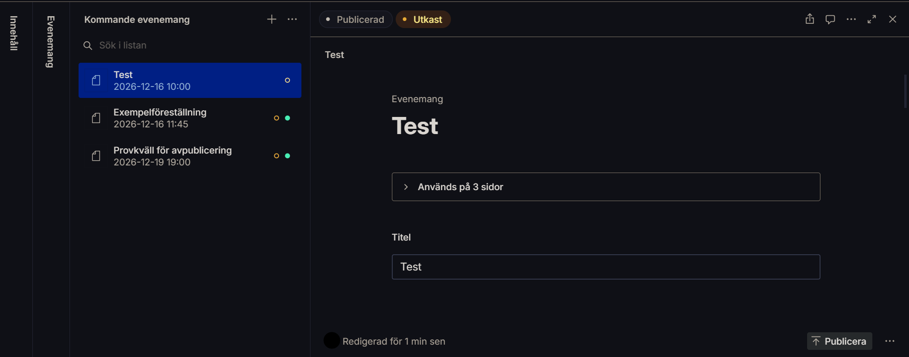

## Avpublicera, ta bort och ångra

### Se vad du har ändrat

Klicka på de tre prickarna (**...**) högst upp i formuläret och välj **Granska ändringar**. Där ser du vad du har ändrat sedan senaste publiceringen.

### Ångra ändringar innan du har publicerat

1. Klicka på de tre prickarna (**...**) bredvid knappen **Publicera**. Menyn visar **Kassera ändringar** bara när du har ändringar som inte är publicerade.
2. Välj **Kassera ändringar**.
3. En ruta frågar "Är du säker på att du vill kassera alla ändringar sedan senast publicerat?" Klicka på **Kassera ändringar** för att bekräfta, eller **Avbryt**.

   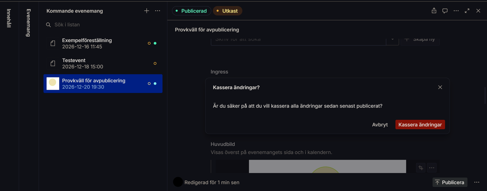

### Ta bort något

Det finns inget val för att bara avpublicera. Vill du ta bort något från webbplatsen raderar du det:

1. Öppna det du vill ta bort.
2. Klicka på de tre prickarna (**...**) bredvid knappen **Publicera** och välj **Radera**.
3. En ruta frågar "Är du säker på att du vill ta bort detta dokument?" och visar dokumentet med dess status, till exempel **Publicerad**. Klicka på **Ta bort dokument** för att bekräfta, eller **Avbryt**.

   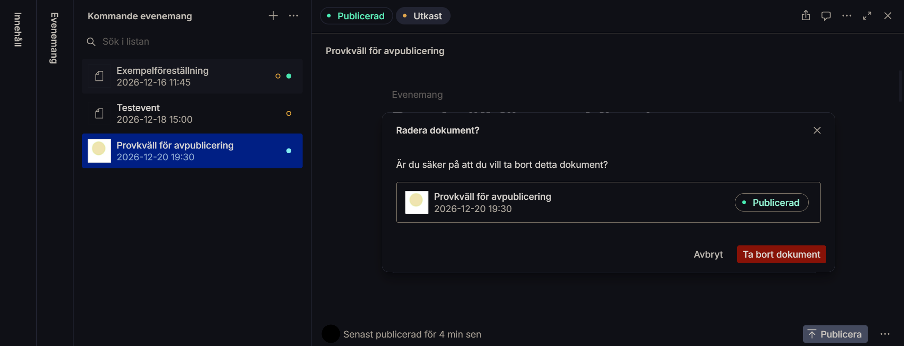

### Om du har publicerat något fel

Du kan se tidigare versioner och skriva tillbaka den text du vill ha.

1. Klicka på de tre prickarna (**...**) högst upp i formuläret och välj **Granska ändringar**.
2. Klicka på fliken **Historik**. Där ser du en lista över när dokumentet skapades, ändrades och publicerades.
3. Klicka på en **Publicerad**-rad. Formuläret visar nu den versionen, och en gul list längst ned säger "Revision från" och datumet.
4. Läs texten du vill ha tillbaka. Klicka på **X** uppe till höger i panelen för att stänga historiken.
5. Skriv in den gamla texten i fältet i formuläret.
6. Klicka på **Publicera**. Ändringen syns på webbplatsen inom en minut.

## Bilder

- Ladda **aldrig** upp foton av personer utan deras tillstånd. Det gäller även bilder från repetitioner och föreställningar.
- Fyll i **Alternativ text** för varje bild. Den beskriver bilden för den som inte ser den, till exempel "Tre skådespelare på scenen". Har bilden ingen alternativ text får fältet en röd ram och du kan inte publicera. Fyll i fältet och klicka sedan på **Publicera** igen.
- Du kan dra en bild till bildfältet, klistra in den, klicka på **Ladda upp** för att välja en fil från datorn, eller klicka på **Välj** för att använda en bild som redan finns i Studio.
- Välj en bild i rimlig storlek.

## Hur lång tid tar det innan ändringen syns?

Efter att du har klickat på **Publicera** ska ändringen synas på webbplatsen inom en minut, se [R008](requirements.md). Vid mätningen tog det som mest drygt 45 sekunder, se [beslut 0021](decisions/0021-content-from-sanity.md#r008-publish-to-visible).

Om ändringen inte syns:

1. Vänta en minut.
2. Ladda om sidan med **Ctrl + Shift + R**.
3. Kontrollera i Studio att fliken **Publicerad** är markerad. Om bara **Utkast** är markerad är ändringen inte publicerad. Klicka på **Publicera**.
4. Syns det fortfarande inte, kontakta systemets förvaltare enligt nästa avsnitt.

## Vem kontaktar du om något går fel?

Kontakta systemets förvaltare: *ingen är utsedd än*. Vem som förvaltar systemet efter praktikperioden är fråga C2 i [open-questions.md](open-questions.md).

Skriv alltid vad du försökte göra och vad som hände. Skicka gärna en skärmbild, men inte om den visar personuppgifter.