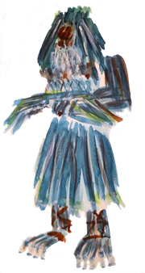
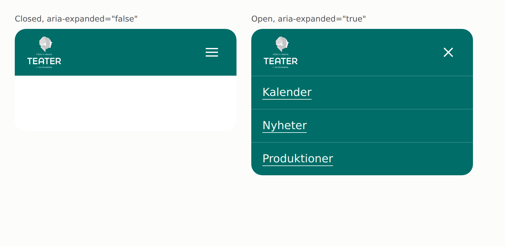
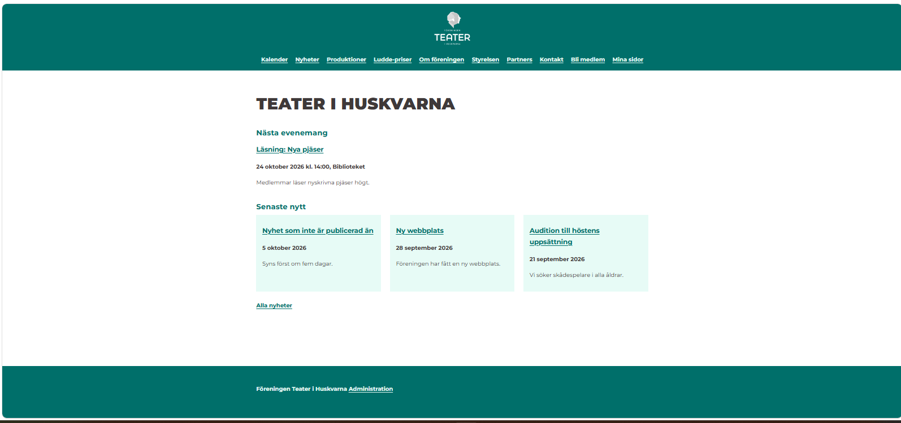

# Style guide

This guide is written by an agent and updated by the assigned team member, and is a default, not a decision. Nothing here is a decision by the user or the product owner. The values were read from the stylesheet and the header template on `main` (commit `8974923`), so the stylesheet is the source of truth: [site.css](../../../src/main/resources/static/css/site.css), [layout.jte](../../../src/main/jte/layout.jte) and [menu.js](../../../src/main/resources/static/js/menu.js). Rows marked TBD are not known yet.

No requirement in [requirements.md](../../requirements.md) asks for this page. R006 #9 in that file ("Fungerar på mobil, tillgänglighet enligt WCAG 2.1 AA") is the nearest one, and it sets the contrast rules below. The same rule is in [projektplan.md](../../projektplan.md), section "Accessibility needs automated and manual checks". See [Sources](#sources) for where every other claim comes from.
 
## Colours

The palette is named by role in `:root` of the stylesheet ([site.css](../../../src/main/resources/static/css/site.css)). Orange `#ee6810` from the old site is dropped on purpose, because it reaches only 3.17:1 on white and 1.96:1 on teal.

| Role | Variable | Value | Used for |
| --- | --- | --- | --- |
| Primary | `--color-primary` | `#006d68` | Header, footer, buttons, `h2`, links |
| Primary, hover | `--color-primary-hover` | `#168a80` | Button hover |
| Light | `--color-light` | `#ebfaf5` | Text on teal (`--color-on-primary`), panels, cards |
| Muted | `--color-muted` | `#3e3939` | Body text (`--color-text`), field borders |
| Dark | `--color-dark` | `#000000` | Focus ring, text on hover |
| White | `--color-white` | `#ffffff` | Page background, fields |
| Error | `--color-error` | `#b3261e` | Error text and invalid fields |

Contrast, as stated in the stylesheet: every text pair reaches 4.5:1 and every interface component 3:1. Examples from the file: error red is 6.54:1 on white and 6.08:1 on mint, black on the hover teal is 4.98:1, and white on the hover teal is only 4.22:1, so button text turns black on hover. Teal against body text is 1.83:1, which is why links are underlined. Change a colour and measure the pairs again.

## Typography

| Use | Style |
| --- | --- |
| Font | Montserrat (self-hosted, variable weight 100 to 900), fallback `sans-serif` |
| Body | 15 px (`0.9375rem`), line height 1.7, colour `#3e3939` |
| `h1` | Uppercase, weight 900, 2.75 rem (1.75 rem under 768 px) |
| `h2` | Teal, weight 700, 1.25 rem |
| Links and labels | Weight 700 |
| Menu items | Weight 700, light on teal |

Bold is used as it is now. Do not add more weights without a reason.

## Shapes

- Square edges (`border-radius:0`) on buttons, fields and tables.No shadows and no gradients.
- Buttons and fields have a 2px border.
- Panels, cards and message use the light colour as background. Messages have a 6px left border, teal for a status and red for an alert.
- the focus ring is 3px black, and light inside the header and footer.

## Underlines in the menu

Links are underlined everywhere, the menu included: bold, 1px underline, 3px on hover. The underlines 
on the desktop menu therefore already follow into the mobile menu, so the site looks the same on desktop and mobile.

## Components Desktop

| Component | States | Notes |
| --- | --- | --- |
| Header | One | Teal. Logo in the center, the menu in one centred row under it|
| Menu | Always open | Ten links in one row that wraps when screen is narrow|
| Footer | One | Teal, bold assocasion name and a link to administration. Left as it is |
| Buttons | Rest, hover, focus | Teal with light text. Secondary: white with teal text|
| Forms | buttons, cards, error messages | TBD | 

## Components Mobile
| Component| States| Notes|
| ---| ---| --- |
| Header | One | Logo centred, 4.5 rem high |
| Menu button | Closed (`aria-expanded="false"`), open (`aria-expanded="true"`) | A bordered button with the text "Meny", light on teal. No icon |
| Menu | Hidden until the button is pressed | The same ten links as on desktop, centred and wrapping. Works without JavaScript: the menu then stays open |
| Footer | One | Left as it is on the old site |
| Forms, buttons, cards, messages | As on desktop | Gutter 1.25 rem instead of 1.5 rem |

## Open

- Whether the menu button should show a hamburger and a cross instead of the word "Meny". The old site uses white icons without a border, `#ffffff` on the teal, and a dark side panel `#21282d` for the open menu. The code has neither.
- Whether a person icon should lead to login. The code has none, and "Mina sidor" is the last link in the menu.
- Whether bold should change. The team decides.
- Whether the product owner wants the guide as a task of its own. It is not a requirement.
 
## Brand/UI

The logo exists already from the old site, and the application uses it at `/img/logo-negative.png`. Source files: [design/old-site/assets/brand](../../../design/old-site/assets/brand/)

- 
- 
- 
 

| Item | In the code |
| --- | --- |
| Logo | [logo-negative.png](../../../src/main/resources/static/img/logo-negative.png), 1534 by 1444 pixels, white on teal, with its own lettering ("Föreningen Teater i Huskvarna"). Centred, 6 rem high on desktop and 4.5 rem on mobile, `width: auto`. A link to the start page with the alt text "Föreningen Teater i Huskvarna, till startsidan" |
| Sharpness | A raster file cannot be scaled up or recoloured, so keep its natural proportions and prefer a vector file when the originals arrive from the association |

 ## Icons/UX

Icons exist already from the old site, in [design/old-site/assets/icons](../../../design/old-site/assets/icons/). The application has no icons in the header today.

- [arrow-right-long.svg](../../../design/old-site/assets/icons/arrow-right-long.svg)
- [facebook.svg](../../../design/old-site/assets/icons/facebook.svg)
- [instagram-square.svg](../../../design/old-site/assets/icons/instagram-square.svg)

| Item | Today | Old site |
| --- | --- | --- |
| Menu button, closed | The word "Meny" in a bordered button | Three thin white lines, `#ffffff`, no border |
| Menu button, open | The same button, `aria-expanded="true"` | A white cross, `#ffffff`, on a dimmed header |

## Preview

Renderings of the header as it is on `main`, made from the real stylesheet and header markup. They are not the old site and not a design proposal. The menu items are the real ones.

## Sources

| Claim | Source |
| --- | --- |
| Colours, typography, shapes, components, breakpoint | [site.css](../../../src/main/resources/static/css/site.css) on `main`, commit `8974923` |
| Header, menu links, logo markup | [layout.jte](../../../src/main/jte/layout.jte) |
| Menu button behaviour | [menu.js](../../../src/main/resources/static/js/menu.js) |
| Contrast 4.5:1 for text | [WCAG 2.1, success criterion 1.4.3, Contrast (Minimum)](https://www.w3.org/TR/WCAG21/#contrast-minimum) |
| Contrast 3:1 for icons | [WCAG 2.1, success criterion 1.4.11, Non-text Contrast](https://www.w3.org/TR/WCAG21/#non-text-contrast) |
| Accessibility is required at level AA | R006 #9 in [requirements.md](../../requirements.md), and [projektplan.md](../../projektplan.md) |
| Old site's menu button, icons and drawer colours | Screenshots of the old site, 2026-10-16, sampled by an agent. They are not stored in the repository |
| The old site's logo image, its size and link | Page source of [Föreningen byter hemsida – Teater i Huskvarna](https://teaterihuskvarna.se/news/foreningen-byter-hemsida/), fetched 2026-10-15 |
| Logo wanted centred with its text, recognisable old style, originals come with the WordPress credentials | [Meeting 1](../../meetings/2026-09-24-meeting-1.md) (C20, C21) and [meeting 2](../../meetings/2026-09-30-meeting-2.md) (C24) |
| Terms such as member page and login | [GLOSSARY.md](../../../GLOSSARY.md) |